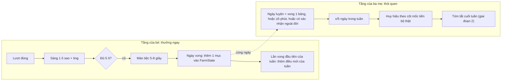

# 01 — Đặc tả sản phẩm: "Học cùng Lạc Lạc"

> Phiên bản 0.1 — nháp chờ Bao duyệt — 24/10/2026
> Ký hiệu dùng xuyên suốt: `⚠️ CẦN XÁC NHẬN` = chi tiết lâm sàng/sư phạm phải hỏi cô giáo. `GĐ-xx` = giả định đang dùng (bảng đầy đủ ở `08`). `F-xx` = tính năng MVP. `US-xx` = user story.

## 1. Định vị

| Điều | Nội dung |
|---|---|
| Người dùng chính | Bé Lạc (sinh 01/2024). Bé luôn chơi **cùng ba mẹ**. |
| Người dùng thứ hai | Ba mẹ: thực hiện chính hằng ngày, thu âm/chụp ảnh, xác nhận, xem dữ liệu. |
| Người xem | Cô giáo ở trung tâm: xem dữ liệu mỗi buổi gặp, cho câu lệnh, tiêu chí. |
| Mô hình | Ba mẹ thực hiện chính + chuyên gia hướng dẫn định kỳ. App **hỗ trợ, không thay thế** can thiệp. |
| Không tuyên bố | Không "chữa", không "cải thiện tự kỷ", không chẩn đoán, không tiên lượng. Mọi chuỗi chữ trong app và báo cáo phải qua danh sách từ cấm (xem `09` §6). |
| Dữ liệu | Toàn bộ nằm trên iPad. Không backend ở MVP. Ảnh/giọng của bé không rời thiết bị. |

## 2. Phạm vi

### 2.1 MVP (giai đoạn 1, 31/10–27/11/2026 theo phương án A của `07` §1.2; brief nêu 31/10–20/11)

| ID | Tính năng | Ghi chú |
|---|---|---|
| F-01 | Khung PWA, offline, màn "chạm để bắt đầu" | Mở khóa âm thanh iOS |
| F-02 | Chế độ ba mẹ (nút giữ 1,5 giây ở màn chờ; cổng vô hình giữ 3 giây trong buổi) | Không phải ranh giới bảo mật (GĐ-20) |
| F-03 | Quản lý nội dung: nhập ảnh, thu âm giọng ba mẹ | Ảnh/giọng không commit lên git/Pages |
| F-04 | Engine bài tập chạy theo JSON + **5 loại trò** phủ đủ 18 bài của cô: `choose_from_two`, `peekaboo`, `say_name`, `sequence_cards`, `coach_demo` | Xem `10` để biết bài nào dùng trò nào |
| F-05 | Học không lỗi + ghi mức gợi ý | Hình đúng nổi lên; không âm báo sai |
| F-06 | `ItemScheduler` bản đơn giản + tạo buổi học hằng ngày | 70/30, xáo vị trí |
| F-07 | Bảng sao 5 ô + thưởng mỗi lượt | Gật đầu, giọng ba mẹ, "ting" |
| F-08 | Màn tiệc 2D (5–8 giây) | Khung cố định |
| F-09 | Chọn phần thưởng + bảng "Đầu tiên – Sau đó" | Chọn 1 trong 2 trước buổi |
| F-10 | Bước cầu nối 4 bậc + `GeneralizationCheck` + `Milestone` | Sau mỗi bài |
| F-11 | Nghi thức kết thúc (linh vật vẫy tay → đi ngủ) | Cố định |
| F-12 | Mục tiêu hằng ngày của bé + ghi `FarmState` | Chỉ ghi dữ liệu; chưa hiển thị nông trại |
| F-13 | Mục tiêu tuần của ba mẹ (`PracticeGoal`, `WeeklyGoal`) | Không chuỗi ngày |
| F-14 | Xem lại buổi học + bảng tiến độ tuần | Sửa mức gợi ý, bỏ lượt, cảnh báo thiên vị vị trí |
| F-15 | Sao lưu / khôi phục file | iOS có thể xóa dữ liệu |
| F-16 | Ghi `Session`/`Trial` sạch + `schemaVersion` + interface `ResponseDetector`, `ItemScheduler` | Nền cho AI giai đoạn 2 |
| F-17 | Cài đặt giác quan: tắt chuyển động, âm lượng, chất lượng cao/nhẹ, tiệc yên lặng | |
| F-18 | Route `/farm` lazy-load (rỗng) | Chỉ dựng route |

### 2.2 Phần hoãn vì ngân sách (GĐ-17)

Brief liệt kê Ú òa và Xếp tranh trong MVP. Rà lại ước lượng (`07` 0.2): phạm vi đầy đủ cần 19,0 ndc, công suất 3 tuần chỉ 16,5 ndc. Theo phương án A (thêm tuần 5), các mục dưới đây làm ở tuần 5 (task T24) và là **thứ bị bỏ trước tiên** nếu hụt thời gian:

| Thứ tự bỏ | Mục | Ảnh hưởng cổng "bé chơi trọn 1 buổi" |
|---|---|---|
| 1 | `sequence_cards` (FIN-03, Xếp tranh) | Không |
| 2 | `peekaboo` (IMI-01, Ú òa) | Không |
| 3 | `offline_guide` (bài chỉ ghi nhận ngoài đời) | Không |
| 4 | Huy hiệu hiển thị đẹp (vẫn ghi `Milestone`) | Không |

**Bao cần duyệt:** chọn phương án A/B/C ở `07` §1.2 (brief nói MVP có Ú òa + Xếp tranh và kết thúc 20/11).

### 2.3 Để sau

| Giai đoạn | Nội dung |
|---|---|
| 2 | Nông trại 3D (mỗi lần vào 1–2 phút; chạm con vật → kêu + giọng ba mẹ gọi tên; con vật chỉ được thêm sau khi mục tương ứng "đạt ngoài đời"), đồ chơi ảo (hạt, khối, trái cây), chế độ hai người, biểu đồ, nhắc lịch, tóm tắt cuối tuần, điều chỉnh độ khó tự động, báo cáo tuần bằng LLM, linh vật Rive/làm mẫu động tác |
| 3 | Camera (MediaPipe), micro (VAD), nhận từ riêng, nút AAC, video mẫu, báo cáo PDF, thử 5–10 gia đình |
| 4 | Tài khoản, đồng bộ (Supabase), cổng cô giáo, trợ lý ba mẹ (RAG), thu phí, Capacitor/App Store |

## 3. User story

### 3.1 Bé Lạc (trải nghiệm mong muốn)

| ID | Story | Tính năng |
|---|---|---|
| US-B1 | Khi chạm màn hình "bắt đầu", Lạc Lạc thức dậy và vẫy tay chào. | F-01, F-07 |
| US-B2 | Con chọn một trong hai phần thưởng trước khi học, và thấy nó nằm ở ô "Sau đó". | F-09 |
| US-B3 | Con nghe giọng ba/mẹ gọi tên một hình, chạm vào hình, và được khen ngay. | F-04, F-07 |
| US-B4 | Nếu con chọn khác hoặc chưa chọn, hình đúng nhẹ nhàng nổi lên; con không nghe tiếng "sai" nào. | F-05 |
| US-B5 | Mỗi lần đúng, một ngôi sao sáng kèm tiếng "ting"; đủ 5 sao thì có tiệc. | F-07, F-08 |
| US-B6 | Khi xong, Lạc Lạc vẫy tay rồi đi ngủ, và con biết tiếp theo là điều con đã chọn. | F-11 |
| US-B7 | Mỗi ngày xong buổi, nông trại của con có thêm một thứ nhỏ (hiển thị từ giai đoạn 2). | F-12 |

### 3.2 Ba mẹ

| ID | Story | Tính năng |
|---|---|---|
| US-P1 | Tôi chụp/nhập ảnh đồ của nhà và thu giọng mình cho từng hình, để bé nghe đúng câu lệnh quen thuộc. | F-03 |
| US-P2 | Tôi chọn 2–3 bài cho tuần; app tự dựng buổi học mỗi ngày. | F-06, F-13 |
| US-P3 | Tôi dừng buổi bất cứ lúc nào mà không bị tính là "thất bại". | F-02, F-13 |
| US-P4 | Sau mỗi bài, app nhắc tôi làm bước ngoài đời (thẻ giấy → đồ thật → tự nhiên) và tôi bấm xác nhận kết quả. | F-10 |
| US-P5 | Tôi sửa mức gợi ý mà app tự ghi nếu tôi đã cầm tay bé. | F-14 |
| US-P6 | Tôi thấy số ngày luyện trong tuần (mặc định 5/7) và lỡ một ngày không mất gì. | F-13 |
| US-P7 | Tôi xem tỷ lệ tự làm theo tuần, xu hướng mức gợi ý, và cảnh báo khi bé chỉ chọn một bên. | F-14 |
| US-P8 | Tôi sao lưu ra file và khôi phục khi cần. | F-15 |
| US-P9 | Tôi tắt chuyển động/giảm âm lượng nếu bé khó chịu. | F-17 |

### 3.3 Cô giáo (MVP: gián tiếp qua ba mẹ; không có tài khoản)

| ID | Story | Cách đáp ứng ở MVP |
|---|---|---|
| US-T1 | Tôi cho câu lệnh, thứ tự gợi ý, tiêu chí đạt; app dùng đúng như vậy. | Bao cập nhật cấu hình JSON sau buổi họp (`06`) |
| US-T2 | Tôi xem số liệu tuần của bé ngay trong buổi gặp. | Ba mẹ mở "Tiến độ" (F-14) |
| US-T3 | Tôi biết bậc nào bé đã làm được ngoài đời. | Lịch sử `GeneralizationCheck` (F-10, F-14) |
| US-T4 | (Giai đoạn 3–4) Báo cáo PDF, tạo bài bằng mô tả. | Để sau |

## 4. Tiêu chí chấp nhận (MVP)

Mỗi dòng phải kiểm được trên iPad thật. ID dạng `AC-F04-2` = tính năng F-04, tiêu chí 2.

| Tính năng | Tiêu chí chấp nhận |
|---|---|
| **F-01** PWA + chạm để bắt đầu | **1.** Cài được lên Màn hình chính iPad, mở ở chế độ standalone. **2.** Bật chế độ máy bay, mở app: vào được và chơi trọn 1 buổi. **3.** Sau mở app nguội, giọng ba mẹ không phát cho đến khi có một chạm trên màn "chạm để bắt đầu"; sau chạm, âm thanh phát. **4.** Sau khi app bị gián đoạn âm thanh (khóa màn hình, cuộc gọi), màn "chạm để tiếp tục" hiện lại và âm thanh phục hồi. |
| **F-02** Chế độ ba mẹ | **1.** Ở màn chờ S02 có nút **thấy được**, nhấn giữ ≥1,5 giây mới vào. **2.** Trong buổi học, chỉ vào được bằng cổng vô hình ở góc trên-trái, nhấn giữ ≥3 giây. **3.** Thả sớm: không vào, không báo lỗi, không có chữ. **4.** Chạm nhanh/nhiều ngón không vào được. **5.** Cả hai lối hoạt động với **sự kiện cảm ứng thật** trên iPad, kể cả khi ngón tay rung nhẹ trong lúc giữ. **6.** Trong buổi, nhấn giữ cho menu: Tạm dừng / Dừng buổi / Về trang ba mẹ; dừng buổi không hiện từ "thất bại". |
| **F-03** Quản lý nội dung | **1.** Chọn ảnh từ thư viện, ảnh được nén lại và EXIF (kể cả GPS) bị loại. **2.** Ảnh PNG có nền trong suốt (tách chủ thể của iPad) giữ nền trong suốt. **3.** Thu âm ≤5 giây, nghe lại, thu lại, lưu; phát được sau khi tắt mở app; có thể nhập file âm thanh thay cho thu trực tiếp. **4.** Mục chỉ vào buổi học khi có ảnh và đủ các vai âm mà bài yêu cầu (`requiredAudio`; COG-01/COG-03: câu lệnh, lời khen, cầu nối). Thiếu gì thì ba mẹ thấy đúng thứ đó. **5.** Ảnh/âm thanh nằm trong IndexedDB; kiểm tra tab mạng: không có request nào chứa nội dung. |
| **F-04** Engine + 5 loại trò | **1.** `choose_from_two`: đúng 2 hình, mỗi hình ≥1/3 diện tích màn, nền trơn, không chữ. **2.** Bài thêm mới (một file JSON hợp lệ) chạy được mà không sửa code TypeScript. **3.** JSON sai schema bị từ chối kèm lỗi cho Bao; không làm app crash. **4.** Vị trí đích xáo trộn: trong buổi 5 lượt, mỗi bên 2–3 lần, không quá 3 lượt liên tiếp cùng một bên. **5.** Bài khai loại trò hoặc detector mà app chưa cài thì **bị bỏ qua**, không bao giờ hiện cho bé một màn chạm không ăn. **6.** Lỗi bất kỳ trong buổi học không được làm trắng màn: bé vẫn thấy linh vật, ba mẹ có nút về trang ba mẹ. **7.** `coach_demo` luôn hiện hình của chính hoạt động đó (bài đường hầm hiện đường hầm), không hiện mục đang xoay vòng. |
| **F-05** Học không lỗi | **1.** Chạm hình sai hoặc chờ 5 giây (cấu hình): hình đúng nổi lên nhẹ (≤600 ms, không rung), lặp lại câu lệnh 1 lần; **không** âm báo sai, không đổi sang màu đỏ, không trừ sao. **2.** Lượt kết thúc khi bé chạm hình đúng. **3.** Trial ghi `correctFirstTry`, `appCue`, `promptLevel` (`independent` nếu không cần gợi ý; `gesture` nếu có gợi ý của app), `promptLevelSource='auto'`. **4.** Chạm trong lúc câu lệnh còn đang phát được gắn cờ và không tính là lựa chọn đầu. **5.** Quá 15 giây sau gợi ý vẫn không chạm: màn hình giữ nguyên, không có tiếng, ba mẹ tự quyết (không tự tính thất bại). |
| **F-06** Scheduler + tạo buổi | **1.** Mỗi ngày mở app, "Bắt đầu buổi học" tạo 1 buổi từ bài trong `WeeklyGoal`. **2.** Với N=5 lượt: 1 lượt mục mới + 4 lượt mục đã biết khi có mục mới (GĐ-07). **3.** Chưa có mục nào "đã biết": toàn bộ là mục mới, vẫn chạy bình thường. **4.** `ItemScheduler` là interface; thay bản cài đặt không sửa engine (kiểm bằng một scheduler giả trong test). |
| **F-07** Bảng sao + thưởng lượt | **1.** Mỗi lượt hoàn thành sáng 1 ô theo thứ tự, kèm nốt "ting" tăng dần. **2.** Thưởng mỗi lượt gồm: linh vật gật đầu, giọng ba mẹ khen có nhắc lại từ. **3.** Hiệu ứng thưởng mỗi lượt ≤1,2 giây, trong ngưỡng "yên tĩnh" của `04`. **4.** Không có cơ chế mất sao; tổng số sao tích lũy chỉ tăng. |
| **F-08** Màn tiệc | **1.** Hiện sau bảng sao đủ 5 ô; kéo dài 5–8 giây. **2.** Linh vật nhảy, bong bóng, đoạn nhạc ngắn, các con vật vừa học chạy qua kèm tiếng kêu. **3.** Khung giữ nguyên mỗi ngày, chỉ biến tấu nhẹ (màu bong bóng/điệu nhảy). **4.** Không nhấp nháy quá 2 lần/giây, không đỏ chói. **5.** Hai công tắc độc lập: "Tắt chuyển động" → tiệc thành khung tĩnh chuyển mờ, không bong bóng, không hạt (phần âm giữ nguyên); "Tiệc yên lặng" → giữ nguyên phần hình, bỏ nhạc tiệc, chỉ còn tiếng kêu con vật ở âm lượng nhỏ (`03` §5, `04` §4). |
| **F-09** Chọn thưởng + Đầu tiên–Sau đó | **1.** Trước buổi, hiện 2 hình phần thưởng (lấy ngẫu nhiên từ danh sách ba mẹ cài, GĐ-16). **2.** Hình bé chọn xuất hiện ở ô "Sau đó" cạnh ô "Đầu tiên" trong suốt buổi và ở lúc kết thúc. **3.** Phần thưởng đã chọn được lưu trong `Session.rewardChoice`. **4.** Không có phần thưởng nào là iPad cho bài ngoài đời. |
| **F-10** Bước cầu nối | **1.** Sau tiệc của mỗi bài, màn cầu nối hiện kèm giọng "Giờ tìm con chó thật nào!" (cho mục vừa học). **2.** Ba mẹ chọn bậc (2/3/4) và kết quả: *Bé làm được / Cần giúp / Chưa* → ghi `GeneralizationCheck` (bậc, ngày, người xác nhận). **3.** "Để sau" là lựa chọn hợp lệ, không ghi kết quả âm. **4.** Một mục chỉ được gắn trạng thái "Đạt ngoài đời" theo GĐ-05. **5.** Khi đạt ngoài đời, tạo `Milestone` (ví dụ "Lạc chọn đúng con chó ngoài đời!"). |
| **F-11** Nghi thức kết thúc | **1.** Luôn cùng một trình tự: linh vật vẫy tay → hiện lại hình "Sau đó" → linh vật đi ngủ → màn hình tĩnh. **2.** Không có nội dung nào chạm được để bắt đầu thêm; chỉ ba mẹ mới thoát. **3.** Kết thúc sớm (ba mẹ dừng) cũng chạy nghi thức rút gọn. |
| **F-12** Mục tiêu hằng ngày của bé | **1.** Ngày được coi là "xong" khi bảng sao vòng 1 đủ 5 ô và tiệc đã chạy. **2.** Khi xong ngày, ghi 1 mục vào `FarmState` (hoa/cây/sinh vật nhỏ); không bao giờ xóa. **3.** Con vật gắn mục chỉ được thêm khi mục đạt ngoài đời. **4.** Điều mới hằng tuần ghi vào lần xong ngày đầu tiên của tuần, không phụ thuộc kết quả; điều mới của tuần bỏ lỡ vẫn được cấp ở các lần xong ngày kế tiếp (tối đa 1 mục/ngày), không mất. **5.** Chưa có hiển thị nông trại (chỉ route rỗng). |
| **F-13** Mục tiêu tuần ba mẹ | **1.** Mặc định 5/7 ngày, sửa được 1–7; tối thiểu 5 phút/ngày, sửa được. **2.** Ngày tính là "ngày luyện" theo GĐ-21. **3.** Màn hình tuần hiển thị "x/5 ngày", ngày chưa làm là vòng rỗng trung tính (không đỏ, không dấu X). **4.** Không có chuỗi ngày liên tục ở bất kỳ màn hình nào. **5.** `WeeklyGoal` gồm 2–3 bài; app gợi ý giữ lại bài tuần trước, ba mẹ chỉnh được. |
| **F-14** Xem lại + tiến độ | **1.** Sau buổi, danh sách lượt cho phép sửa mức gợi ý (lưu `promptLevelSource='parent_edit'` và giữ giá trị gốc) và đánh dấu lượt không hợp lệ (`valid=false`). **2.** Bảng tuần: ngày luyện (Q5), số bảng (Q6), tỷ lệ tự làm theo bài (Q1), phân bố mức gợi ý (Q2). **3.** Cảnh báo thiên vị khi >80% lượt chọn đầu cùng một vị trí (GĐ-24); kiểm bằng **dữ liệu mẫu** 5/5 lượt (một buổi) và 13/15 lượt (3 buổi), không kiểm bằng buổi thật; văn bản trung tính, kèm "hỏi cô giáo". **4.** Số liệu khớp với truy vấn Q1–Q6 trong `06` (kiểm bằng dữ liệu mẫu). |
| **F-15** Sao lưu | **1.** Xuất 1 file `.zip` qua Share Sheet hoặc tải về. **2.** Nhập file ở chế độ "Thay thế" trên máy vừa xóa sạch khôi phục đủ dữ liệu và media. **3.** File hỏng/sai phiên bản bị từ chối với thông báo rõ, dữ liệu hiện tại không bị thay đổi. **4.** Nhắc sao lưu tối đa 1 lần/tuần, ngôn ngữ trung tính. **5.** Máy chưa có dữ liệu: app tự tạo hồ sơ bé (`DEFAULT_CHILD`) và gói khởi đầu, không hỏi gì — ba mẹ mở app là chơi được (GĐ-15). |
| **F-16** Ghi dữ liệu + interface | **1.** Mọi bản ghi có `schemaVersion`, `id` (ULID), `createdAt`, `updatedAt`. **2.** Trial ghi đủ các trường trong `06` §2.5. **3.** Crash giữa buổi: mở lại app, buổi được đóng thành `abandoned`, các trial đã xong còn nguyên. **4.** Engine không import trực tiếp bất kỳ detector cụ thể nào ngoài registry. |
| **F-17** Cài đặt giác quan | **1.** "Tắt chuyển động" áp dụng ngay cho mọi màn của bé. **2.** Âm lượng tổng, âm lượng tiệc chỉnh riêng. **3.** Mặc định không nhạc nền. **4.** Hai mức chất lượng "cao/nhẹ" chuyển được và nhớ lại. |
| **F-18** Route nông trại | **1.** `/farm` tồn tại, tải lazy, hiển thị màn rỗng không có chữ (bé) khi chưa có nội dung. **2.** Bundle chính không chứa three.js/R3F (kiểm bằng báo cáo bundle). |

## 5. Hệ thống mục tiêu hai tầng

### 5.1 Nguyên tắc

Bé Lạc sinh 01/2024, tức chưa tròn 3 tuổi trong kỳ MVP. Giả định đang dùng: bé chưa theo được chuỗi ngày hay phần thưởng chậm ⚠️ CẦN XÁC NHẬN với cô giáo → **thưởng ngay trong ngày cho bé**. Người cần động lực duy trì là ba mẹ → **mục tiêu tuần mềm cho ba mẹ**.

### 5.2 Quy tắc tính hoàn thành

| Đối tượng | Quy tắc | Giả định |
|---|---|---|
| Lượt xong | Bé chạm hình đúng (có hoặc không có gợi ý). Học không lỗi nên mọi lượt đều kết thúc đúng | — |
| Sáng 1 sao | Mỗi lượt xong | — |
| Bảng sao xong | 5 lượt xong trong 1 vòng | GĐ-06 |
| **Ngày của bé xong** | Bảng sao vòng 1 đủ + tiệc đã chạy. Vòng 2 là phần thêm, không bắt buộc | GĐ-06 |
| **Ngày luyện của ba mẹ** | Ngày xong của bé **hoặc** tổng thời gian buổi ≥ `minMinutesPerDay` (mặc định 5) **hoặc** có xác nhận cầu nối ngoài đời trong ngày | GĐ-21 |
| Tuần đạt | Số ngày luyện ≥ `daysPerWeek` (mặc định 5) | — |
| Tuần: hạn | Thứ Hai–Chủ nhật, múi giờ Asia/Ho_Chi_Minh | GĐ-12 |
| Mục "đạt trên iPad" | Theo từng mục: 5 buổi gần nhất có mục đó, tự làm đúng ≥80%, tổng ≥6 lượt. Cửa sổ là 5 buổi vì 1 vòng/ngày × 5 lượt chia cho 4 mục chỉ cho ~1,25 lượt/mục/buổi (`06` Q4) | GĐ-04 ⚠️ CẦN XÁC NHẬN |
| Mục "đạt ngoài đời" | ≥2 xác nhận *Bé làm được* ở bậc 3 hoặc 4, vào ≥2 ngày khác nhau | GĐ-05 ⚠️ CẦN XÁC NHẬN |
| Tự làm đúng | `correctFirstTry && promptLevel==='independent'` | — |

### 5.3 Phần thưởng

| Tầng | Phần thưởng | Thời điểm | Có thể mất? |
|---|---|---|---|
| Bé | Gật đầu + giọng khen + "ting" | Mỗi lượt | Không |
| Bé | Màn tiệc | Hết bảng sao | Không |
| Bé | Phần thưởng thật bé chọn (ô "Sau đó") | Sau buổi | Không |
| Bé | +1 mục nông trại (hoa/cây/sinh vật nhỏ) | Ngày xong | **Không bao giờ** |
| Bé | Điều mới của tuần (điệu nhảy/phụ kiện/con vật) | Ngày xong đầu tiên của tuần; tuần bỏ lỡ thì cộng dồn lần sau, không mất | **Không bao giờ** (GĐ-22) |
| Ba mẹ | Huy hiệu cột mốc: buổi học đầu tiên, mục đạt trên iPad, mục đạt ngoài đời, tuần đủ ngày luyện (`06` `MilestoneKind`) | Khi điều kiện xảy ra | Không. Không có huy hiệu âm; tuần chưa đủ ngày thì **không có dấu hiệu nào** (không huy hiệu, không nhắc, không đánh dấu) |
| Ba mẹ | Tóm tắt cuối tuần (giai đoạn 2) | Chủ nhật | — |

Vì nông trại 3D ở giai đoạn 2, MVP **ghi** `FarmState` nhưng chưa **hiển thị**; bé nhận thưởng thấy được trong MVP là bảng sao + tiệc + ô "Sau đó".

### 5.4 Những gì tuyệt đối không làm

| Cấm | Cách kiểm |
|---|---|
| Chuỗi ngày liên tục hoặc đếm "đã bỏ lỡ" | Tìm kiếm trong code/chuỗi UI: không có `streak`, "bỏ lỡ", "đứt" |
| Linh vật buồn, trách móc, gây cảm giác có lỗi (kể cả thông báo, trạng thái "nhớ bạn") | Danh sách trạng thái linh vật trong `04` không có trạng thái buồn; nhắc lịch chỉ dùng câu trung tính |
| Mất sao, hoa, cây, con vật, huy hiệu đã có | Mọi bảng thưởng là append-only; không có thao tác xóa trong UI |
| Âm báo sai, màu đỏ chỉ lỗi, rung màn hình | Kiểm trước khi cho bé dùng (`07`) |
| Ép đủ chỉ tiêu | Ba mẹ dừng buổi bất kỳ lúc nào; buổi dừng sớm vẫn lưu, không hiện từ "thất bại"/"chưa hoàn thành" cho ba mẹ trong lịch tuần |
| Dùng iPad làm phần thưởng cho bài ngoài đời | Phần thưởng của ô "Sau đó" **luôn** là hoạt động ngoài iPad (GĐ-16); S19 không cho thêm phần thưởng dạng xem video/chơi iPad; checklist `07` §7 kiểm trước mỗi buổi |
| Tuyên bố y khoa | Rà từ cấm trong mọi chuỗi giao diện, báo cáo |

## 6. Cấu trúc một buổi học (20–25 phút, iPad tối đa 10 phút)

| Bước | Ai dẫn | Tối đa | Trong app |
|---|---|---|---|
| 1. Mở đầu bằng người thật | Ba mẹ | ~3 phút | Màn ba mẹ "Sẵn sàng": gợi ý chào, hát, ôm; bấm "Đưa iPad cho bé" |
| 2. iPad | App + ba mẹ ngồi cùng | **10 phút** (GĐ-06 ⚠️) | Chạm để bắt đầu → chọn thưởng → Đầu tiên–Sau đó → bảng sao → tiệc |
| 3. Áp dụng ngoài đời | Ba mẹ | ~5 phút | Màn cầu nối + xác nhận |
| 4. Kết thúc bằng trò bé thích | Ba mẹ | ~3–5 phút | Nghi thức kết thúc → hiện ô "Sau đó" |

Brief nêu 15–20 phút; tổng các bước trên là 21–23 phút. Có thể rút bước 1 và 4 còn ~2 phút để về 15–20 phút ⚠️ CẦN XÁC NHẬN với cô giáo (GĐ-06).

Luồng màn hình chi tiết ở `03`.

## 7. Phụ thuộc vào cô giáo (đánh dấu ⚠️)

| Mục | Dùng mặc định |
|---|---|
| Câu lệnh chuẩn mỗi bài | GĐ-01 |
| Thứ tự và định nghĩa mức gợi ý | GĐ-02 |
| Thời gian chờ trước gợi ý | GĐ-03 |
| Tiêu chí đạt trên iPad / ngoài đời | GĐ-04, GĐ-05 |
| Định nghĩa "đúng" của từng bài (đặc biệt bài vận động, bắt chước) | `02` |
| Cách xử lý khi bé thiên vị một bên | App chỉ cảnh báo, không tự đổi |
| Số lượt mỗi bảng (5), số vòng (2), thời lượng iPad mỗi buổi (10 phút) | GĐ-06, GĐ-10 ⚠️ |
| Định nghĩa "ngày luyện", số ngày/tuần (5/7), số phút tối thiểu (5) | GĐ-21 ⚠️ |
| Lượt đầu của vòng là mục đã biết; cách xoay vòng giữa 2–3 bài trong tuần | GĐ-27, GĐ-30 ⚠️ |
