# 03 — Luồng màn hình & UX

> Phiên bản 0.1 — nháp chờ Bao duyệt. Quy ước: **chế độ bé** (không chữ, ảnh thật, yên tĩnh), **chế độ ba mẹ** (có chữ, thông tin). `GĐ-xx` xem `08`.

## 1. Sơ đồ màn hình

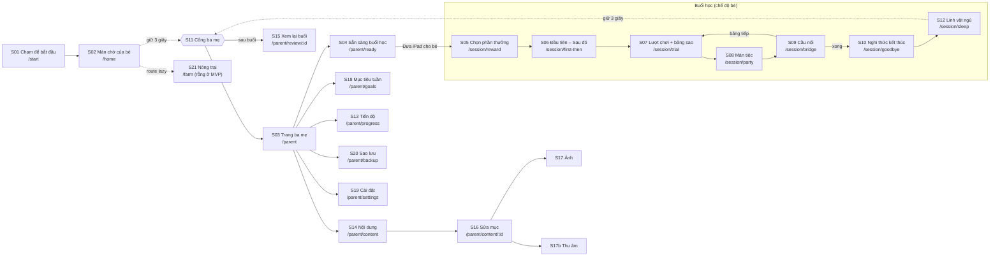

| ID | Màn | Chế độ | Nội dung chính | Tương tác |
|---|---|---|---|---|
| S01 | Chạm để bắt đầu | Bé | Linh vật ngủ ở giữa, 1 vòng sáng nhẹ | Chạm bất kỳ → mở khóa âm thanh, linh vật thức dậy vẫy tay |
| S02 | Màn chờ | Bé + thanh ba mẹ ở mép dưới | Linh vật idle; **nút "Giữ 1,5 giây để mở trang ba mẹ"** luôn thấy ở mép dưới | Chạm linh vật → gật đầu (không bắt đầu gì); ba mẹ nhấn giữ nút để vào S03 |
| S03 | Trang ba mẹ | Ba mẹ | Nút "Bắt đầu buổi học", thẻ tuần (x/5 ngày), lối tắt | Chạm |
| S04 | Sẵn sàng | Ba mẹ | Danh sách bài hôm nay, 4 bước buổi học, gợi ý mở đầu bằng người thật | "Đưa iPad cho bé" |
| S05 | Chọn phần thưởng | Bé | 2 ảnh phần thưởng lớn | Chạm 1 hình |
| S06 | Đầu tiên – Sau đó | Bé | 2 ô: [Học cùng Lạc Lạc] → [hình thưởng đã chọn] | Tự chuyển sau giọng ba mẹ (~4 giây) |
| S07 | Lượt chơi | Bé | Bảng sao 5 ô, 2 hình lựa chọn | Chạm |
| S08 | Màn tiệc | Bé (rộn ràng) | Xem mục 5 | Không có |
| S09 | Cầu nối | Hai lớp: lớp bé (không chữ) + thanh ba mẹ | Linh vật + ảnh mục vừa học + giọng "Giờ tìm con chó thật nào!" | Ba mẹ nhấn giữ thanh xác nhận |
| S10 | Nghi thức kết thúc | Bé | Linh vật vẫy tay → ô "Sau đó" → ngủ | Không có |
| S12 | Linh vật ngủ | Bé | Hình tĩnh | Chạm → "zzz" nhẹ, không làm gì khác |
| S11 | Cổng ba mẹ | Cả hai | Vòng tiến trình mờ | Giữ 3 giây |
| S13 | Tiến độ | Ba mẹ | Xem mục 8 | |
| S15 | Xem lại buổi | Ba mẹ | Danh sách lượt, sửa mức gợi ý, ghi chú | |
| S14–S17b | Nội dung / ảnh / thu âm | Ba mẹ | Xem mục 7 | |
| S18 | Mục tiêu tuần | Ba mẹ | Chọn 2–3 bài; số ngày; số phút | |
| S19 | Cài đặt | Ba mẹ | Âm lượng tổng/tiệc, tắt chuyển động, tiệc yên lặng, chất lượng, ghi đè thời gian chờ, **danh sách phần thưởng thật (`rewardKeys`, chọn từ mục `category='reward'`)**, hướng dẫn Guided Access/cài PWA | |
| S20 | Sao lưu | Ba mẹ | Xem mục 9 | |
| S21 | Nông trại | Bé | Màn rỗng (MVP) | |
| — | *(Không có màn thiết lập)* | — | App chỉ dùng cho một bé nên hồ sơ (`DEFAULT_CHILD`: Lạc, 2024-01) và gói khởi đầu được tạo sẵn ở lần mở đầu tiên. Khôi phục sao lưu nằm ở S20 | |

Màn lượt chơi (S07), hướng ngang:

```text
┌──────────────────────────────────────────────────────────┐
│  ★ ★ ☆ ☆ ☆                                    (cao ~10%) │
│ ┌──────────────────────┐ ┌──────────────────────┐        │
│ │                      │ │                      │        │
│ │      ảnh A           │ │      ảnh B           │  ~76%  │
│ │  (≥1/3 diện tích)    │ │  (≥1/3 diện tích)    │        │
│ └──────────────────────┘ └──────────────────────┘        │
│ ◌ cổng ba mẹ (ẩn)                       linh vật ló ra   │
└──────────────────────────────────────────────────────────┘
```

Hướng dọc: hai hình xếp trên-dưới, cùng quy tắc diện tích (GĐ-13).

## 2. Bắt đầu buổi học

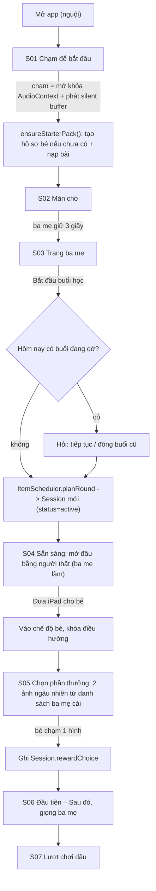

| Quy tắc | Chi tiết |
|---|---|
| Cold launch luôn qua S01 | iOS chỉ cho phát âm thanh sau một chạm (`04`, `05`) |
| Không có nút "Chơi" cho bé ở S02 | Buổi học do ba mẹ dẫn (nguyên tắc: ba mẹ luôn ngồi cùng) |
| S05 | Nếu bé không chạm sau 10 giây: hình ngẫu nhiên nổi nhẹ; nếu vẫn không chạm sau thêm 10 giây, ba mẹ có thể chạm hộ (ghi `rewardChoiceBy='parent'`) |
| S06 | Hiển thị đúng 2 ô; "Sau đó" **luôn** là hoạt động ngoài iPad (GĐ-16) |

## 3. Vòng lặp một lượt

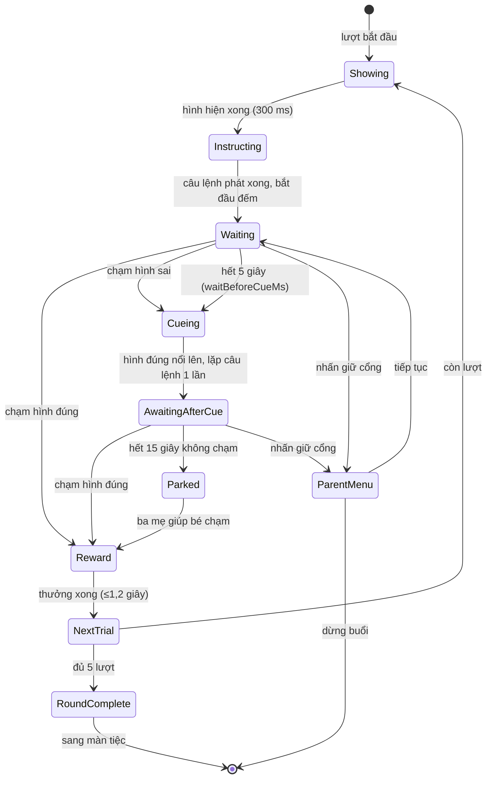

| Trạng thái | Việc app làm | Ghi dữ liệu |
|---|---|---|
| Showing | Hai ảnh mờ dần vào 300 ms. Vị trí đích theo `ItemScheduler` (xáo trộn cân bằng) | `displayed[]`, `targetSlot` |
| Instructing | Phát câu lệnh giọng ba mẹ. Chạm lúc này bị gắn `phase='before_audio_end'`, không tính lựa chọn đầu | `instructionStartMs/EndMs` |
| Waiting | Đếm `waitBeforeCueMs` (mặc định 5000). Chạm: phản hồi chạm trung tính (nhún 2%) cho cả hai hình, **không âm** | `touches[]` |
| Cueing | Hình đúng nổi nhẹ (scale 1→1,06, ≤600 ms, không rung/nháy). Lặp câu lệnh 1 lần. Hình sai giữ nguyên (không mờ, không đỏ) | `appCue{reason,atMs}`; `promptLevel='gesture'` |
| AwaitingAfterCue | Chờ chạm hình đúng; chạm hình sai: không phản hồi thêm | `touches[]` |
| Parked | Không làm gì thêm: không tiếng, không chữ. Ba mẹ tự cầm tay hoặc dừng | `parked=true` |
| Reward | Hình đúng sáng nhẹ; linh vật gật đầu; giọng ba mẹ: "Đúng rồi, con chó!"; sao sáng + "ting" | `completedAt`, `latency` |
| NextTrial | Tự động, ghi `Trial`. Ghi Session snapshot (khôi phục khi crash) | `trials`, `sessions` |

Quy tắc liên quan: nếu bé chạm cùng một bên > 80% số lượt, ghi cờ và hiển thị cảnh báo cho ba mẹ **sau buổi** (không làm gián đoạn bé) — GĐ-24.

## 4. Bước cầu nối

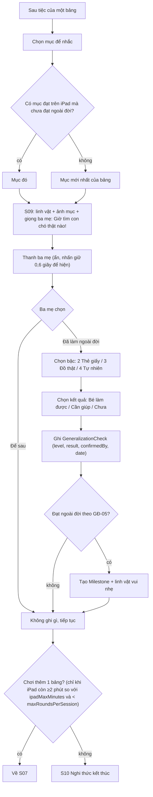

- Màn S09 là nơi **ba mẹ rời iPad cùng bé** để tìm đồ thật; không có đếm giờ, không có áp lực.
- Thanh xác nhận chỉ hiện khi nhấn giữ nhẹ để bé không bấm nhầm.
- "Để sau" và "Chưa" đều hợp lệ; không ghi lỗi, không hiện đỏ.
- Trong MVP, gợi ý cách làm ở bậc 2/3/4 là văn bản mẫu gắn từng bài (`bridge.levels` trong JSON, `06` §4.2). ⚠️ CẦN XÁC NHẬN nội dung với cô giáo.
- S09 chạy **hai lớp**: lớp của bé (linh vật + ảnh mục, **không chữ**) và thanh xác nhận của ba mẹ (`data-ui="parent"`), chỉ hiện sau khi nhấn giữ 0,6 giây và tự ẩn sau khi chọn. Quy tắc "không chữ ở chế độ bé" (`04` §2) áp dụng cho lớp của bé; lớp ba mẹ được phép có chữ.

## 5. Màn tiệc (5–8 giây, khung cố định)

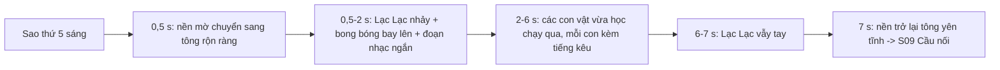

| Thành phần | Giá trị | Biến tấu hằng ngày (nhẹ) |
|---|---|---|
| Tổng thời lượng | 5–8 giây, mục tiêu 7 | Không đổi |
| Khung (thứ tự bước) | Cố định | Không đổi |
| Màu bong bóng | 4 bảng màu | Xoay vòng theo ngày |
| Điệu nhảy | 1 mặc định | + điệu mới theo tuần (giai đoạn 2) |
| Con vật chạy qua | Tối đa 3, từ các mục xuất hiện trong bảng | Theo bảng |
| Âm lượng | `partyVolume` (mặc định 60%, GĐ-09) | — |

| Biến thể giác quan | Hành vi |
|---|---|
| "Tắt chuyển động" | Khung tĩnh (linh vật + con vật) chuyển mờ, không bong bóng, không hạt; phần âm giữ nguyên |
| "Tiệc yên lặng" | Giữ nguyên phần hình; bỏ nhạc tiệc; chỉ còn tiếng kêu con vật ở âm lượng nhỏ |
| Chất lượng "nhẹ" | Ít hạt (40 thay vì 120), không bóng đổ |
| Cấm | Nhấp nháy >2 lần/giây, đỏ chói toàn màn, rung màn hình |

Bé không thể bỏ qua tiệc (≤8 giây). Ba mẹ có thể dừng bằng cổng 3 giây.

## 6. Chuyển màn & nghi thức kết thúc

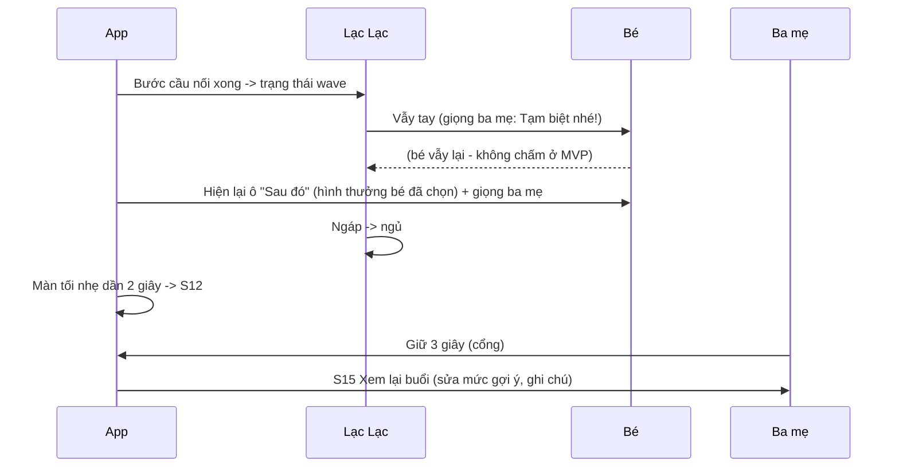

| Quy tắc chuyển màn | Giá trị |
|---|---|
| Kiểu chuyển | Chỉ mờ dần (cross-fade) 300–400 ms. Không trượt, không lật, không zoom |
| Chuyển yên tĩnh ↔ rộn ràng | Đi qua nền trơn trung tính, 300 ms |
| Âm thanh khi chuyển | Fade-out 100 ms trước khi đổi màn |
| S12 (ngủ) | Không có tương tác bắt đầu thêm; chạm = "zzz" nhẹ |
| Kết thúc sớm do ba mẹ | Chạy nghi thức rút gọn (vẫy tay → ngủ); `Session.status='stopped_by_parent'`; **không** hiện từ "thất bại" |
| Hết thời gian iPad (≥10 phút) | Sau lượt hiện tại, sang tiệc (nếu đủ 5 sao) hoặc nghi thức rút gọn; không cắt giữa lượt |

## 7. Chế độ ba mẹ, nội dung (thu âm + chụp ảnh)

### 7.1 Vào chế độ ba mẹ

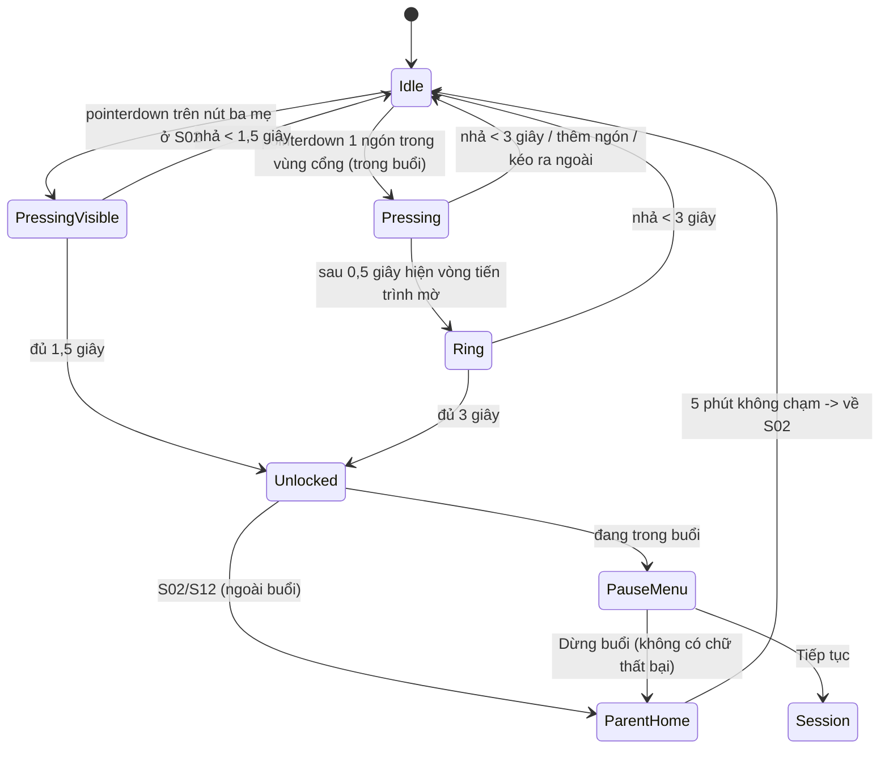

Có **hai lối vào**, cùng mục đích là ngăn bé vô tình vào chứ không phải bảo mật (GĐ-20):

| Lối | Ở đâu | Giữ | Vì sao |
|---|---|---|---|
| Nút thấy được | S02 màn chờ, mép dưới | 1,5 giây | Màn chờ không phải màn học; cổng vô hình ở đây làm **ba mẹ** không tìm ra đường vào (đã xảy ra trên iPad thật) |
| Cổng vô hình | Các màn trong buổi học, vùng 120×120 px góc trên-trái, không có hình ảnh | 3 giây | Trong buổi phải tuyệt đối không có gì để bé chạm nhầm |

Ngoài ra Guided Access khóa thoát app (xem `05`).

### 7.2 Chụp/nhập ảnh nội dung

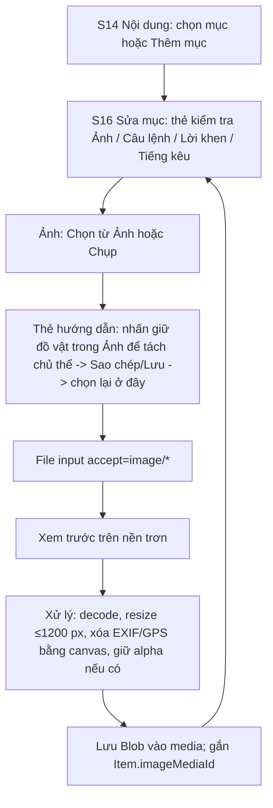

### 7.3 Thu âm

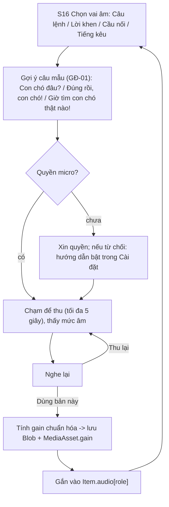

Lưu ý: một mục có thể có nhiều câu lệnh/lời khen (xoay vòng) để tránh lặp máy móc; MVP khuyến nghị tối thiểu 1 câu lệnh + 2 lời khen. ⚠️ CẦN XÁC NHẬN câu lệnh với cô giáo **trước** khi thu hàng loạt.

## 8. Xem tiến độ (MVP: bảng, không biểu đồ)

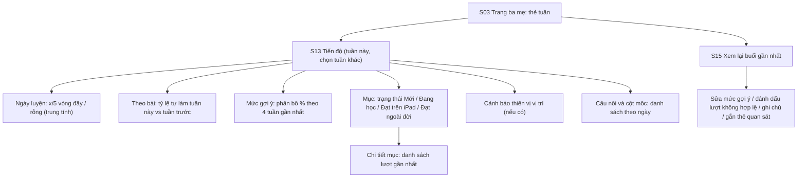

| Khối | Dữ liệu (truy vấn ở `06` §5) | Ghi chú ngôn ngữ |
|---|---|---|
| Ngày luyện | `PracticeGoal` + `Q5` (GĐ-21) | "3/5 ngày" — không từ "bỏ lỡ" |
| Tỷ lệ tự làm | `Q1` | Hiển thị % và n lượt |
| Mức gợi ý | `Q2` | Kèm xu hướng (↗ ↘ →) trung tính |
| Thiên vị | `Q3` | "Bé chọn bên trái 5/5 lượt, nên hỏi cô giáo." (⚠️ không đưa lời khuyên lâm sàng) |
| Cầu nối | `GeneralizationCheck`, `Milestone` | Huy hiệu theo tiến bộ thật |

Thêm: nút "Ghi chú cho buổi gặp cô giáo" (văn bản tự do, lưu cục bộ). Báo cáo PDF để giai đoạn 3.

## 9. Sao lưu và khôi phục

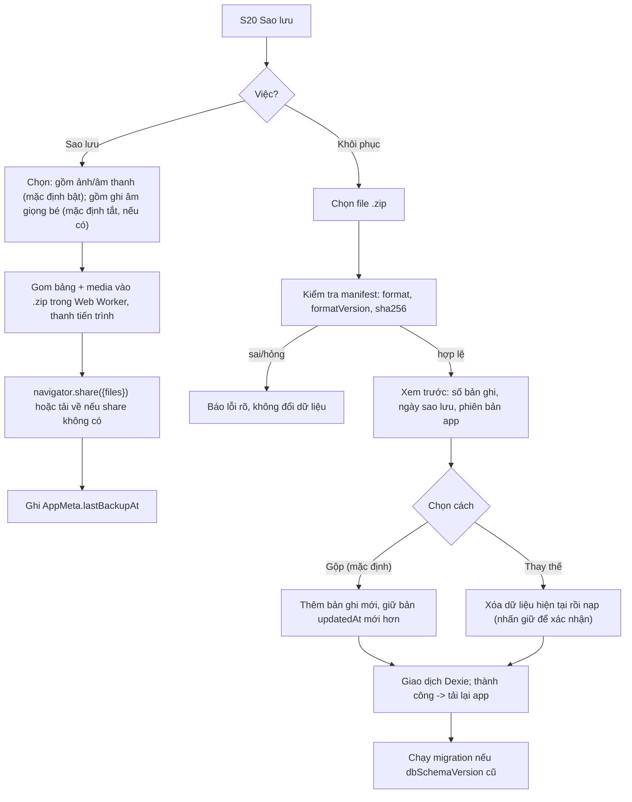

Nhắc sao lưu: thẻ nhỏ ở trang ba mẹ khi `lastBackupAt` > 7 ngày, chữ trung tính ("Nên sao lưu để giữ dữ liệu của Lạc"); ẩn được trong 7 ngày; không bao giờ hiện cho bé.

## 10. Tình huống đặc biệt

| Tình huống | Hành vi |
|---|---|
| Âm thanh bị ngắt (khóa màn hình, cuộc gọi, chuyển app) | Tạm dừng lượt; hiện S01 "chạm để tiếp tục" (linh vật ngủ → thức); sau chạm, lặp lại câu lệnh của lượt hiện tại |
| Thiếu ảnh/giọng của một mục | Mục bị loại khỏi buổi; ba mẹ thấy "Thiếu: câu lệnh (con chó)" ở S04 |
| Không đủ 2 mục để chọn 1/2 | S04 báo cần thêm mục; buổi không bắt đầu |
| Mở app giữa buổi đang dở (crash) | `Session` cũ được đóng thành `abandoned` (các lượt đã ghi còn nguyên) hoặc ba mẹ chọn tiếp tục khi vào S04 |
| Mất dữ liệu (Safari xóa) | App dựng lại hồ sơ và gói khởi đầu (nội dung rỗng). Ba mẹ vào S04 sẽ thấy "chưa đủ nội dung" và khôi phục từ file sao lưu ở S20; thẻ nhắc sao lưu ở S03 cũng hiện lại |
| Ba mẹ muốn dừng giữa chừng | Cổng 3 giây → "Dừng buổi" → nghi thức rút gọn; buổi vẫn tính theo GĐ-21 nếu đủ 5 phút |
