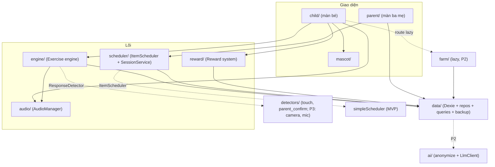
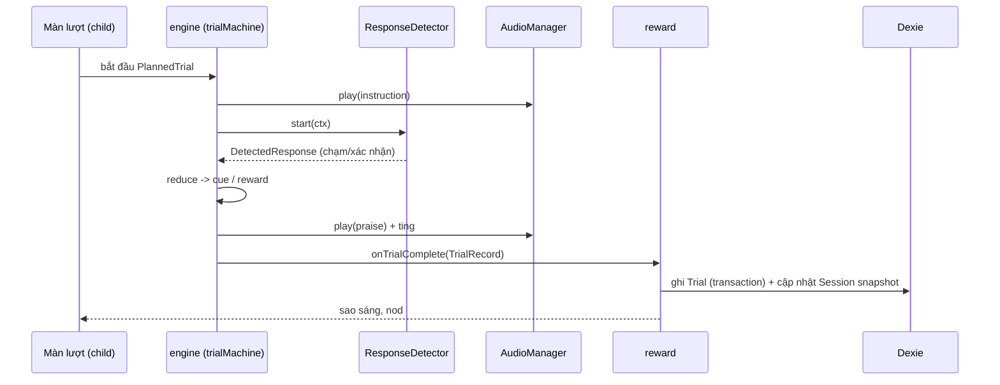
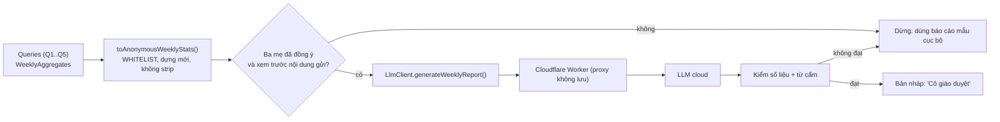

# 05 — Kiến trúc kỹ thuật

> Phiên bản 0.1 — nháp chờ Bao duyệt. Chưa viết code ứng dụng; các đoạn TypeScript dưới đây là **hợp đồng (interface)** để chốt thiết kế. `GĐ-xx` xem `08`.

## 1. Quyết định chính

| Hạng mục | Chọn | Lý do ngắn |
|---|---|---|
| Build / UI | Vite + React + TypeScript (strict) | Theo brief |
| PWA | `vite-plugin-pwa` (Workbox `generateSW`, `registerType: 'prompt'`) | Offline, kiểm soát lúc cập nhật |
| Lưu trữ | IndexedDB qua Dexie; ảnh/âm thanh dạng `Blob` | Theo brief |
| Animation UI | Framer Motion | Theo brief |
| Linh vật | MVP: SVG + Framer Motion; P2: Rive (GĐ-14) | Giảm 1 ngày công; API `<LacLac state>` giữ nguyên khi đổi |
| Âm thanh | **Web Audio API trực tiếp** (AudioBuffer đã giải mã), không Howler | Nguồn là Blob trong IndexedDB; cần gain, ducking, sự kiện `ended` chính xác; ~150 dòng |
| Ghi âm | `MediaRecorder` (dò định dạng hỗ trợ) | Theo brief |
| 3D (P2) | `react-three-fiber` + `drei`, glTF nén Draco, **lazy-load** | Theo brief; MVP chỉ dựng route |
| Router | `react-router` (route lazy cho `/farm`) | |
| State phiên chạy | Zustand | Nhẹ, không boilerplate |
| Truy vấn dữ liệu | `dexie-react-hooks` (`useLiveQuery`) | UI tự cập nhật |
| Kiểm tra JSON | Zod (sinh JSON Schema từ Zod để tài liệu hóa) | Một nguồn sự thật |
| ID | ULID | Sắp xếp theo thời gian, tạo offline, sẵn sàng đồng bộ |
| Nén sao lưu | `fflate` (zip) | Nhỏ, chạy trong Worker |
| Kiểm thử | Vitest + `fake-indexeddb` | Logic thuần: scheduler, truy vấn, sao lưu |
| Hạ tầng | Cloudflare Pages (tĩnh), chưa backend | Theo brief |
| Phân tích/telemetry | **Không** (không SDK bên thứ ba) | Dữ liệu bé không rời thiết bị |

Phiên bản thư viện: lấy bản ổn định mới nhất khi dựng khung (tuần 1) và khóa trong lockfile.

## 2. Cấu trúc thư mục

```text
app-hoc-cung-laclac/
├─ docs/                      # tài liệu này
├─ ASSETS.md                  # nhật ký tài nguyên (tạo ở tuần 1)
├─ public/
│  ├─ icons/                  # PWA icons (tự tạo)
│  └─ starter/                # gói khởi đầu: ảnh/âm CC0 đã ghi ASSETS.md (KHÔNG có dữ liệu của bé)
├─ src/
│  ├─ app/                    # App.tsx, routes, providers, ErrorBoundary, TapToStart
│  ├─ child/                  # chế độ bé: screens/ (Home, RewardChoice, FirstThen, Trial, Party, Bridge, Goodbye, Sleep)
│  ├─ parent/                 # chế độ ba mẹ: gate/, home/, content/, goals/, progress/, review/, backup/, settings/
│  ├─ engine/                 # exercise engine
│  │  ├─ schema/              # Zod + JSON Schema của ExerciseConfig
│  │  ├─ trialMachine.ts      # reducer trạng thái một lượt
│  │  ├─ games/               # choose_from_two/ (P1); peekaboo/, sequence_cards/ (P2) ...
│  │  ├─ detectors/           # touchChoice.ts, parentConfirm.ts, registry.ts (ResponseDetector)
│  │  └─ registry.ts          # type -> GameModule
│  ├─ scheduler/              # ItemScheduler, simpleScheduler.ts, sessionService.ts, mastery.ts
│  ├─ audio/                  # AudioManager, unlock.ts, recorder.ts, normalize.ts
│  ├─ data/
│  │  ├─ db.ts                # Dexie + versions
│  │  ├─ types.ts             # interface (xem 06)
│  │  ├─ repos/               # children, items, sessions, trials, ...
│  │  ├─ queries/             # Q1..Q5 báo cáo
│  │  ├─ backup/              # export.ts, import.ts, manifest.ts, worker.ts
│  │  └─ starter/             # nạp gói khởi đầu vào IndexedDB (idempotent)
│  ├─ reward/                 # starBoard, rewardService, dailyGoal, practiceCalendar, milestones, farmLedger
│  ├─ mascot/                 # <LacLac state />, states.ts
│  ├─ farm/                   # FarmScene (lazy). MVP: stub rỗng
│  ├─ ui/                     # tokens.css, components dùng chung (Card, HoldButton, ...)
│  ├─ i18n/vi.ts              # mọi chuỗi hiển thị; không viết chữ cứng trong component
│  └─ lib/                    # time.ts (tuần, múi giờ), random.ts (xáo trộn có hạt giống), ulid.ts
├─ content/                   # JSON bài tập (exercises/*.json) — dữ liệu, không phải code
├─ local-content/             # (gitignore) ảnh/giọng của nhà dùng khi thử; chỉ nhập qua app
├─ tests/
└─ vite.config.ts, tsconfig.json, public/_headers, public/_redirects
```

Quy tắc: `engine` không import `parent` hay `child`; `child`/`parent` chỉ nói chuyện với `engine`, `scheduler`, `reward`, `data` qua API công khai của từng module.

## 3. Các module



| Module | Trách nhiệm | API chính | Không làm |
|---|---|---|---|
| **Exercise engine** (`engine/`) | Nạp `Exercise` JSON, kiểm bằng Zod, chọn `GameModule` theo `type`, chạy máy trạng thái lượt, phát sự kiện `TrialRecord` | `loadExercise(id)`, `useTrial(plannedTrial)`, `registerGame(type, module)` | Chọn mục (việc của scheduler); tính thưởng |
| **Session scheduler** (`scheduler/`) | `ItemScheduler` + `SessionService`: dựng buổi, vòng; mở/đóng `Session`; phục hồi buổi dở | `planRound()`, `startSession()`, `closeSession(status)` | Hiển thị |
| **Audio manager** (`audio/`) | Mở khóa, tải/giải mã Blob, phát, ducking, gain, hàng chờ, phục hồi sau gián đoạn | `unlock()`, `preload(mediaIds)`, `play(id, opts)`, `playSeq()`, `duck()`, `onInterrupted()` | Biết gì về bài tập |
| **Data layer** (`data/`) | Dexie schema có version, repo, truy vấn báo cáo, sao lưu | `db`, `repos.*`, `queries.*`, `backup.*` | Logic UI |
| **Reward system** (`reward/`) | Bảng sao; thưởng lượt; màn tiệc kích hoạt; mục tiêu ngày của bé; ngày luyện của ba mẹ; `Milestone`; sổ `FarmState` (chỉ thêm) | `onTrialComplete`, `onRoundComplete`, `onSessionClosed`, `isPracticeDay(date)` | Xóa thưởng (không có API xóa) |
| **Farm scene** (`farm/`) | MVP: stub; P2: R3F + glTF; `FarmScene` nhận `FarmState` + `quality` | `<FarmScene state quality />` (lazy) | Chạy ngoài route `/farm` |
| **Parent mode** (`parent/`) | Cổng 3 giây; nội dung; mục tiêu; tiến độ; xem lại; sao lưu; cài đặt | Route `/parent/*` | Chạy khi bé đang ở buổi (trừ menu tạm dừng) |
| **Mascot** (`mascot/`) | `<LacLac state />`, bảng trạng thái | `state ∈ idle|wake|nod|jump|wave|yawn|sleep|…` | Giọng nói |

### 3.1 Ghi một lượt (đường dữ liệu chính)



Quy tắc: Trial được ghi trong **một transaction** khi lượt kết thúc; `Session` cập nhật snapshot ngay sau (để khôi phục khi crash).

## 4. Quản lý state

| Loại | Nơi lưu | Ví dụ |
|---|---|---|
| Lịch sử/nội dung (nguồn sự thật) | **IndexedDB (Dexie)** | `Trial`, `Session`, `Item`, `MediaAsset` |
| Cài đặt bé | Dexie (`Child.settings`) → đọc vào `settingsStore` lúc khởi động | `reduceMotion`, `masterVolume`, `waitBeforeCueMs` |
| Runtime một buổi | **Zustand** (`sessionStore`) | vòng/lượt hiện tại, số sao, `phase` |
| Runtime UI | Zustand (`uiStore`) | `mode`, `parentUnlocked`, `audioReady`, `quality` |
| Một lượt | `useReducer` trong `trialMachine` (thuần, test được) | trạng thái `Waiting`/`Cueing` |
| Dẫn xuất | Tính từ Dexie bằng `queries/` | Tỷ lệ tự làm, trạng thái mục (Mới/Đang học/Đạt trên iPad/Đạt ngoài đời) |

Không có bảng `ItemProgress` ở MVP: tính từ `Trial` (vài nghìn dòng, nhanh); thêm bảng cache ở giai đoạn 2 nếu đo thấy chậm.

## 5. PWA và offline

| Chủ đề | Thiết kế |
|---|---|
| Manifest | `name: "Học cùng Lạc Lạc"`, `short_name: "Lạc Lạc"`, `display: standalone`, `background_color`/`theme_color` = `--bg`, icon 192/512/maskable + `apple-touch-icon` 180 |
| Meta iOS | `apple-mobile-web-app-capable`, `apple-mobile-web-app-status-bar-style`, `viewport-fit=cover` |
| Precache | Toàn bộ shell + chunk + `public/starter/`; chunk `/farm` **precache nhưng không thực thi** (P2) |
| Cập nhật | `registerType: 'prompt'`: khi có bản mới chỉ hiện thẻ trong chế độ ba mẹ ("Có bản mới – Cập nhật"); áp dụng bằng thao tác của ba mẹ; **không bao giờ** cập nhật giữa buổi |
| Điều hướng | `navigateFallback: /index.html` (SPA) |
| Cache runtime | Không có (không có tài nguyên từ xa); mọi nội dung nằm trong IndexedDB |
| CSP (`public/_headers`) | `default-src 'self'; img-src 'self' blob: data:; media-src 'self' blob:; connect-src 'self'; style-src 'self' 'unsafe-inline'; frame-ancestors 'none'` — **`connect-src 'self'` làm ràng buộc kỹ thuật**: app không thể gửi dữ liệu ra ngoài. P2 (LLM) thêm đúng một origin của Worker. |
| Hosting | Cloudflare Pages; build `vite build`; `_redirects`: `/* /index.html 200` |
| Nội dung của bé | Không bao giờ nằm trong git, build hay Pages (`local-content/` trong `.gitignore`) |

## 6. Xử lý các lưu ý riêng của iOS

| # | Vấn đề | Cách xử lý | Kiểm chứng (P0-6) |
|---|---|---|---|
| 1 | Âm thanh chỉ mở sau cử chỉ người dùng | Màn S01 "chạm để bắt đầu": `audioContext.resume()` + phát buffer câm trong handler chạm. Sau gián đoạn (`statechange` → `interrupted`/`suspended`, `visibilitychange`): hiện S01 lại | Mở nguội, chạm, nghe được |
| 2 | Công tắc im lặng của iPad tắt Web Audio | Đặt `navigator.audioSession.type = 'playback'` nếu có; nếu không, hướng dẫn ba mẹ trong cài đặt | Thử với công tắc/Control Center *(chưa kiểm chứng, cần thử máy thật)* |
| 3 | Safari có thể xóa dữ liệu web lâu không dùng | Gọi `navigator.storage.persist()`; app cài vào Màn hình chính; **sao lưu ra file** + nhắc mỗi 7 ngày; khi DB trống, app dựng lại hồ sơ rỗng và ba mẹ khôi phục ở S20 | Kiểm `persist()` trả về gì |
| 4 | Không `beforeinstallprompt` | Màn hướng dẫn Chia sẻ → Thêm vào MH chính (ảnh minh họa) trong S19 | |
| 5 | Khóa màn hình app | **Guided Access** (Cài đặt → Trợ năng → Truy cập được hướng dẫn; nhấn ba lần nút nguồn trên iPad Pro 11" không có nút Home): màn hướng dẫn trong cài đặt ba mẹ | Thử trong buổi |
| 6 | Hướng màn hình không khóa được từ manifest | Thiết kế responsive; ngang là chính, dọc hỗ trợ (GĐ-13) | |
| 7 | Định dạng ghi âm | Dò `MediaRecorder.isTypeSupported` theo thứ tự `audio/mp4`, `audio/webm;codecs=opus`; lưu `mime`; phát bằng `decodeAudioData` | Ghi → phát lại |
| 8 | Quyền micro/camera trong PWA | Xin ở thời điểm ba mẹ bấm "Thu âm"; có hướng dẫn khi bị từ chối | Kiểm quyền có nhớ sau khi mở lại không |
| 9 | Màn hình tự khóa giữa buổi | Xin `navigator.wakeLock` khi vào buổi (nếu có); khuyến nghị Guided Access/đặt Tự khóa | *(chưa kiểm chứng trong PWA)* |
| 10 | Cử chỉ hệ thống, kéo-làm-mới, zoom, giữ ảnh | `overscroll-behavior: none`, `touch-action: manipulation`, `-webkit-touch-callout: none`, `user-select: none`, `img{ -webkit-user-drag:none; pointer-events:none }` | |
| 11 | Blob trong IndexedDB | Lưu `Blob` trực tiếp; nếu spike thất bại → lưu `ArrayBuffer` | Lưu/đọc 20 MB |
| 12 | Xuất file | `navigator.share({files})`; dự phòng `<a download>` | Chia sẻ .zip vào Tệp |
| 13 | Giới hạn WebGL (P2) | Một `Canvas`; hủy renderer khi rời `/farm` | |
| 14 | Safe area / Home indicator | `env(safe-area-inset-*)`, `viewport-fit=cover` | |

Mọi mục `*(chưa kiểm chứng…)*` là giả định từ kiến thức chung về Safari, **phải xác nhận ở spike tuần 1 (P0-6)** và cập nhật bảng này.

## 7. Hai mức chất lượng

Cài đặt `quality: 'high' | 'light'` (mặc định `high` trên iPad Pro M1; đổi trong cài đặt ba mẹ; áp dụng ngay).

| Tham số | `high` | `light` |
|---|---|---|
| Pixel ratio tối đa | `min(devicePixelRatio, 2)` | 1 |
| Hạt tiệc | 120 | 40 |
| Bóng đổ/hiệu ứng làm mờ | Bật | Tắt |
| Linh vật | Đầy đủ lớp | Đơn giản hóa, tắt chớp mắt |
| Nông trại 3D (P2) | Antialias, bóng đổ, texture đầy đủ | Không antialias, texture nhỏ, ≤ ½ số vật thể |
| Khi rời màn 3D | Hủy `Canvas`, `renderer.dispose()`, `frameloop='never'` khi `document.hidden` | Giống |

Gợi ý tự động (P2): nếu đo p95 thời gian khung > 24 ms trong tiệc 3 buổi liên tiếp, thẻ gợi ý ba mẹ chuyển sang `light`; **ba mẹ quyết định** (không tự đổi).

## 8. Điểm mở rộng

### 8.1 `ResponseDetector` (MVP: chạm và ba mẹ xác nhận → P3: camera/micro)

```ts
export type DetectorKind =
  | 'touch_choice' | 'touch_reveal' | 'touch_drag' | 'touch_swipe' | 'touch_button'
  | 'parent_confirm'
  | 'voice_activity'            // P3
  | 'hand_pose' | 'body_pose'   // P3

export interface DetectedResponse {
  kind: DetectorKind
  tMs: number                   // thời điểm, tính từ đầu lượt
  targetId?: string             // item/ô được chọn
  confidence?: number           // 0..1, chỉ detector ML
  payload?: Record<string, unknown>
}

export interface DetectorContext {
  trialId: string
  config: unknown               // phần response.* của ExerciseConfig
  signal: AbortSignal
}

export interface ResponseDetector {
  readonly kind: DetectorKind
  start(ctx: DetectorContext): Promise<void>
  stop(): void
  subscribe(cb: (r: DetectedResponse) => void): () => void
}

export interface DetectorRegistry {
  register(kind: DetectorKind, factory: () => ResponseDetector): void
  create(kind: DetectorKind): ResponseDetector
}
```

Engine chỉ biết `DetectorRegistry` và trường `exercise.response.detector` (chuỗi). P3 thêm `HandPoseDetector`, `VoiceActivityDetector` mà **không sửa engine**. Ở P3, detector ML chỉ **đề xuất** (hiện thanh "Bé vừa vẫy tay?") trong giai đoạn "bóng"; ba mẹ vẫn là người xác nhận cho đến khi độ khớp đạt ngưỡng (xem `09`).

### 8.2 `ItemScheduler` (MVP: luật đơn giản → P2: thích ứng)

```ts
export interface ItemStats {
  itemId: string
  trials: number                       // tổng lượt
  independentCorrect: number
  lastSeenAt: number | null
  recentSessions: { sessionId: string; trials: number; independentCorrect: number }[]
  status: 'new' | 'learning' | 'mastered_ipad' | 'generalized'
}

export interface PlanInput {
  childId: string
  now: number
  exerciseId: string
  /** Lấy từ ExerciseConfig sau khi áp ưu tiên cấu hình (`06` §1) */
  scheduling: { trialsPerRound: number; newItemRatio: number; knownMinTrials: number; firstTrialKnownItem: boolean }
  positions: { maxSameSideRun: number }
  distractor: { avoidRepeatLast: number }
  pool: ItemStats[]                    // đã lọc theo `requiredAudio` của bài + có ảnh
  history: { lastSideRun: number; leftShare: number }   // thiên vị vị trí gần đây
  seed?: number                        // xáo trộn tái lập được
}

export interface PlannedTrial {
  trialIndex: number
  exerciseId: string
  targetItemId: string
  distractorItemIds: string[]          // choose_from_two: 1 phần tử
  targetSlot: 0 | 1                    // 0 = trái/trên
  isNewItem: boolean
  waitBeforeCueMs: number
}

export interface ItemScheduler {
  readonly id: string                  // 'simple@1'
  readonly version: number
  planRound(input: PlanInput): Promise<PlannedTrial[]>
  /** P2: thời gian chờ thích ứng theo từng mục */
  waitBeforeCueMs(itemId: string, defaults: { waitBeforeCueMs: number }): number
}
```

`SimpleItemScheduler` (MVP): `newCount = max(1, floor(scheduling.newItemRatio·N))` khi còn mục mới (GĐ-07); phần còn lại lấy mục đã biết, ưu tiên lâu chưa gặp; vị trí đích cân bằng ±1, chuỗi cùng bên ≤ `positions.maxSameSideRun`; mọi hằng số đến từ JSON bài, không hard-code. Mô tả đầy đủ ở `06` §4.3. `Session` ghi `schedulerId` để so sánh khi thay bằng bản thích ứng.

### 8.3 Lớp gọi LLM (P2) — có bước ẩn danh hóa bắt buộc



```ts
// src/ai/anonymize.ts   (tạo ở giai đoạn 2; MVP KHÔNG có thư mục src/ai)
export interface AnonymousWeeklyStats {
  schemaVersion: 1
  ageMonthsBucket: '24-29' | '30-35' | '36-41'
  weekIndex: number                    // số thứ tự tuần tương đối, không ngày thật
  practiceDays: number
  targetDays: number
  exercises: {
    kind: string                       // mã bài chung, ví dụ 'COG-01'
    trials: number
    independentRate: number            // 0..1
    promptDistribution: Record<PromptLevel, number>
    sideShare: number | null           // tỷ lệ chọn lệch về một vị trí
    newItems: number
    masteredItems: number
  }[]
  generalization: { level: 2 | 3 | 4; didIt: number; withHelp: number; notYet: number }[]
}
// WeeklyAggregates = kết quả Q1–Q5 (`06` §5) gộp theo tuần; định nghĩa chi tiết khi làm P2
export function toAnonymousWeeklyStats(input: WeeklyAggregates): AnonymousWeeklyStats

export interface LlmClient {
  generateWeeklyReport(stats: AnonymousWeeklyStats): Promise<ReportDraft>
}
export interface ReportDraft { text: string; status: 'needs_teacher_review'; model: string; createdAt: number }
```

Quy tắc chi tiết (trường được phép, từ cấm, đồng ý) ở `09` §4 và §6.

### 8.4 Đồng bộ (P4)

| Điều kiện sẵn sàng từ MVP | Cách |
|---|---|
| ID toàn cục, tạo offline | ULID mọi bản ghi |
| Phát hiện thay đổi | `updatedAt` (ms) trên mọi bản ghi; `deletedAt` (xóa mềm) |
| Nguồn thiết bị | `AppMeta.deviceId` |
| Chiến lược xung đột | Bản ghi nhật ký (`Trial`, `GeneralizationCheck`) chỉ thêm; sửa của ba mẹ (`promptLevel`, `valid`) là ghi đè theo `updatedAt` (LWW cấp bản ghi) |
| Hàng đợi | Bảng `syncOutbox` (thêm ở version Dexie mới) |
| Bí mật | Media đồng bộ riêng, mã hóa phía máy khách (đánh giá ở P4); tuân thủ Nghị định 13/2023 |

## 9. Kiểm thử

| Loại | Phạm vi | Công cụ |
|---|---|---|
| Đơn vị | `trialMachine`, `SimpleItemScheduler` (hạn mức mới/cũ, cân bằng vị trí, chọn bài của vòng), tiêu chí đạt (GĐ-04/05), ngày luyện (GĐ-21), truy vấn Q1–Q6 với dữ liệu mẫu, sao lưu vòng tròn, validate JSON | Vitest + `fake-indexeddb` |
| Hợp đồng | Engine chạy một `Exercise` JSON mới mà không đổi code; scheduler giả thay được | Vitest |
| Bất biến thưởng | Sau chuỗi sự kiện bất kỳ (dừng sớm, crash, bỏ ngày, nhập sao lưu dạng gộp): `FarmState.items` và `totalStars` không giảm, `Round.starsLit` không giảm; `reward/` không export hàm xóa (test cấm export) | Vitest |
| Thủ công trên iPad | Danh sách kiểm trước khi cho bé (`07` §5) | Máy thật |

Không kiểm thử chuỗi văn bản giao diện hay chi tiết hiển thị tạm thời; kiểm hành vi, ranh giới, bất biến.

## 10. Rủi ro kiến trúc đã biết

| Rủi ro | Giảm thiểu |
|---|---|
| Quá nhiều trạng thái trong buổi → lỗi hiếm | `trialMachine` là reducer thuần có test; một nguồn `Session.phase` |
| Blob lớn làm chậm khởi động | Tải/giải mã theo buổi (`preload` các mục của vòng), không nạp hết |
| Safari xóa cache SW | Gói khởi đầu nằm trong IndexedDB; cài lại cần mạng 1 lần; sao lưu |
| Worker LLM (P2) mâu thuẫn "chưa cần backend" | Worker không lưu trạng thái, không có DB; ghi rõ ở `08` |
