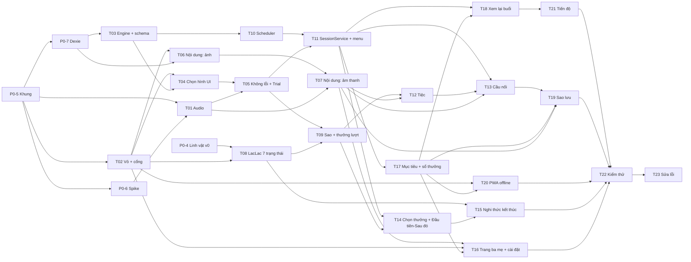

# 07 — Kế hoạch MVP (tuần 1–5)

> Phiên bản 0.2 — nháp chờ Bao duyệt. Thay đổi so với 0.1: **ước lượng được sửa lên sau khi rà soát khối lượng thật**, MVP cần 5 tuần thay vì 4 (xem §1). `GĐ-xx` xem `08`. Tuần trong tài liệu này chạy **Thứ Bảy → Thứ Sáu** theo brief (tuần 1 = 24/10–30/10/2026); khác với tuần Thứ Hai của app (GĐ-12).

## 1. Ngân sách và kết luận khả thi

| Mục | Giá trị |
|---|---|
| Công suất | 20+ giờ/tuần. **Giả định 22 giờ/tuần, 1 ngày công (ndc) = 4 giờ** (GĐ-19) → 5,5 ndc/tuần |
| Tuần 1 (Giai đoạn 0) | 5,0 ndc |
| Tuần 2–4 (công suất) | 16,5 ndc |
| **Phạm vi MVP đầy đủ F-01…F-18** (đã cắt GĐ-17) | **19,0 ndc** (T01–T23) |
| **Thiếu hụt so với 3 tuần** | **2,5 ndc = 10 giờ** |
| Thêm tuần 5 (công suất 22,0 ndc cho tuần 2–5) | Đủ cho 19,0 ndc + 2,0 ndc lấy lại phần cắt GĐ-17 (T24) = 21,0 ndc, còn đệm 1,0 |

### 1.1 Vì sao 0.1 ước lượng thiếu

Bản 0.1 gộp quá nhiều việc vào một dòng. Rà lại theo mô tả trong `01`/`03`/`06`:

| Việc | 0.1 | 0.2 | Lý do |
|---|---|---|---|
| Nội dung (ảnh + âm thanh) | 1,0 | 0,75 + 0,75 | Hai pipeline media riêng (`03` §7.2 và §7.3), mỗi cái 8 bước, cộng 4 màn |
| Linh vật + bảng sao | 1,0 | 0,75 + 0,75 | 7 trạng thái hoạt hình SVG (`04` §7.3) là một task riêng |
| Chọn thưởng + Đầu tiên–Sau đó + nghi thức | 1,0 | 0,75 + 0,5 | 4 màn của bé, mỗi màn có luật chờ và âm riêng |
| Xem lại + tiến độ | 0,75 | 0,75 + 0,75 | S15 (sửa dữ liệu) và S13 (6 khối báo cáo trên Q1–Q6) là hai màn khác nhau |
| Sao lưu | 1,0 | 1,25 | Bản 0.1 bỏ sót đường khởi động lần đầu. **Cập nhật sau khi Bao chốt một-bé-một-iPad:** không làm màn thiết lập nữa — hồ sơ bé (`DEFAULT_CHILD`) và gói khởi đầu được tạo sẵn trong `ensureStarterPack()`; khôi phục sao lưu nằm ở S20 |
| Kiểm thử + sửa lỗi | 1,5 | 0,75 + 0,75 | Tách để không có task > 1 ndc |
| `SessionService` | 0,75 | 1,0 | Thêm menu trong buổi (F-02 AC4) mà bản 0.1 không gán cho task nào |

### 1.2 Ba cách xử lý thiếu hụt — **cần Bao chọn**

| Cách | Nội dung | Hệ quả |
|---|---|---|
| **A. Dời cổng MVP sang 27/11 (khuyến nghị)** | Thêm tuần 5 (21–27/11, 5,0 ndc): S15 Xem lại buổi, S13 Tiến độ, kiểm thử, sửa lỗi, và 2,0 ndc lấy lại phần đã cắt theo GĐ-17 (Ú òa, Xếp tranh, `offline_guide`) | Giai đoạn 2 lùi 1 tuần (21/11–18/12 → 28/11–25/12). Phạm vi giữ nguyên, lấy lại được phần đã cắt. **Bé vẫn chơi thử từ tuần 3 đúng như brief** |
| B. Giữ 20/11, cắt tiếp 2,5 ndc | Bỏ S13 Tiến độ (0,75), bỏ S15 Xem lại buổi (0,75), bỏ UI chọn bài S18 (0,3), tiệc rút gọn (0,4), bỏ hiển thị Milestone (0,2), hướng dẫn Guided Access chỉ là văn bản (0,2) | **Không khuyến nghị:** bỏ S15 làm mất đường sửa mức gợi ý của ba mẹ → dữ liệu kém tin cậy, trái mục tiêu "ghi dữ liệu sạch cho AI giai đoạn 2" |
| C. Giữ 20/11, hạ chuẩn cổng | Cổng 20/11 chỉ gồm: bé chơi trọn một buổi + dữ liệu ghi đúng + sao lưu (đúng mốc M3 ở §3). S15, S13 và kiểm thử đầy đủ sang tuần 5 | Giữ đúng ngày của brief cho phần chơi của bé; ba mẹ chưa có công cụ sửa dữ liệu trong tuần đầu dùng thật |

Kế hoạch dưới đây viết theo **cách A**.

Mỗi task ≤ 1 ndc (riêng T19 = 1,25 vì không tách được: sao lưu và khôi phục dùng chung manifest).

## 2. Kế hoạch theo tuần

### Tuần 1 — Giai đoạn 0: chuẩn bị (24/10–30/10) — 5,0 ndc

| ID | Task | ndc | Phụ thuộc | Sản phẩm | Tính năng |
|---|---|---|---|---|---|
| P0-1 | Họp cô giáo (chương trình `08` §3): câu lệnh chuẩn, thang gợi ý, thời gian chờ, tiêu chí đạt, danh sách đồ cá nhân, quan sát giác quan, định nghĩa "đúng" 3 bài P1, liều lượng buổi học | 0,5 | — | Cập nhật `08` (GĐ → xác nhận) + `confirm` trong JSON | — |
| P0-2 | Ảnh: 4 con vật (tự chụp hoặc CC0, ghi `ASSETS.md`), 6 đồ cá nhân (ba mẹ chụp + tách chủ thể bằng iPad), 4–6 ảnh phần thưởng thật | 0,5 | P0-1 | `local-content/` (không commit) | F-03 |
| P0-3 | Thu âm bằng Voice Memos: ~45 clip theo đúng câu của cô | 0,5 | P0-1 | File âm thanh trong `local-content/` | F-03 |
| P0-4 | Phác thảo linh vật: giấy → Figma → SVG nhiều lớp v0, bảng màu `04` §7, tự kiểm "khác Duolingo" | 0,75 | — | `mascot/*.svg` v0 | F-07, F-11 |
| P0-5 | Dựng khung: Vite + React + TS, vite-plugin-pwa, Vitest, lint, Cloudflare Pages + `_headers` (CSP `connect-src 'self'`), `.gitignore local-content/`, cài lên iPad | 0,75 | — | URL chạy standalone trên iPad | F-01 |
| P0-6 | **Spike iOS trên iPad thật** (bảng dưới) | 0,75 | P0-5 | Cập nhật `05` §6 cột "Kiểm chứng" | F-01 |
| P0-7 | Dexie v1 + `types.ts` + repos + khung nạp gói khởi đầu (idempotent) + ULID + lib thời gian (`weekStartOf`, `localDate`) | 1,0 | P0-5 | `data/` + test | F-16 |
| P0-8 | `ASSETS.md` + chọn nguồn tài nguyên (chỉ Tự tạo/CC0/MIT, `04` §8) | 0,25 | — | `ASSETS.md` | — |

Spike P0-6 (ghi đạt/không đạt từng mục):

| # | Kiểm | Cách làm | Nếu không đạt |
|---|---|---|---|
| 1 | Mở khóa âm thanh bằng chạm; phát lại sau khóa màn hình | Trang thử 1 nút | Thêm S01 lần nữa sau gián đoạn (đã có trong thiết kế) |
| 2 | Công tắc im lặng/âm lượng ảnh hưởng Web Audio? Thử `navigator.audioSession.type='playback'` | Bật/tắt công tắc | Hướng dẫn ba mẹ trong cài đặt |
| 3 | `MediaRecorder`: định dạng dùng được, phát lại bằng `decodeAudioData` | Thu 3 giây | Dùng định dạng dò được; nếu không có, nhập file từ Voice Memos |
| 4 | Quyền micro trong PWA: nhớ sau khi mở lại? | Đóng/mở app | Ghi vào hướng dẫn ba mẹ |
| 5 | Lưu/đọc `Blob` 20 MB trong IndexedDB | Ghi, đóng app, đọc | Chuyển sang `ArrayBuffer` |
| 6 | `navigator.storage.persist()` trả về gì | Gọi và đọc | Tăng cường nhắc sao lưu |
| 7 | `navigator.share({files:[zip]})` lưu vào Tệp | Thử | `<a download>` |
| 8 | Pointer: quệt lòng bàn tay, đa ngón, `pointerup` trên ảnh | Thử bằng tay | Chỉnh `maxMovePx`/`ignoreFirstMs` |
| 9 | `wakeLock` trong PWA standalone | Gọi và để 3 phút | Dựa vào Guided Access/Auto-Lock |
| 10 | Chạy offline sau khi cài (chế độ máy bay) | Mở app | Sửa precache |

**Cổng Giai đoạn 0 (30/10):** có câu lệnh của cô (hoặc ghi rõ còn thiếu), ảnh và giọng cho 2–3 bài, linh vật v0, khung PWA chạy trên iPad, spike xong.

### Tuần 2 — Lõi chơi được (31/10–6/11) — 5,5 ndc

| ID | Task | ndc | Phụ thuộc | Sản phẩm | Tính năng |
|---|---|---|---|---|---|
| T01 | `AudioManager`: mở khóa, tải/giải mã Blob, phát, gain, ducking, phục hồi sau gián đoạn | 1,0 | P0-5, P0-6 | `audio/` | F-01 |
| T02 | Vỏ chế độ bé: token CSS (`04` §2), CSS chống cử chỉ iOS, S01 chạm để bắt đầu, router, cổng ba mẹ giữ 3 giây (+ S02, S03 khung rỗng) | 0,75 | P0-5 | S01→S02→gate→S03 | F-01, F-02 |
| T03 | Schema Zod + sinh JSON Schema + loader + **quy tắc ưu tiên cấu hình** (`06` §1) + `trialMachine` (reducer) + test | 1,0 | P0-7 | `engine/` | F-04, F-16 |
| T04 | `choose_from_two`: layout ≥1/3 màn hình, nhận chạm (`pointerup`, hit-slop, ignore), `TouchChoice` qua `DetectorRegistry` (kế hoạch lượt từ fixture tạm) | 1,0 | T02, T03 | S07 chạy với dữ liệu giả | F-04, F-16 |
| T05 | Học không lỗi: gợi ý (5 giây/chọn sai → hình nổi lên, lặp lệnh), ghi `Trial` đầy đủ (`06` §2.5), snapshot `Session` | 1,0 | T04, T01, P0-7 | Trial ghi đúng trong Dexie | F-05, F-16 |
| T06 | Nội dung — **ảnh**: nhập/chụp, decode, resize ≤1200 px, bỏ EXIF/GPS, giữ alpha, xem trước trên nền trơn, gán `Item.imageMediaId` (S14, S16, S17) | 0,75 | T02, P0-7 | Màn nội dung phần ảnh | F-03 |

**Mốc M1 (6/11):** chơi 1 vòng COG-01 với ảnh thật của nhà trên iPad; Trial ghi vào Dexie. *(Chưa có giọng ba mẹ trong app, chưa có sao/tiệc.)*

### Tuần 3 — Phần thưởng và vòng buổi học (7/11–13/11) — 5,25 ndc · **bé chơi thử từ tuần này**

| ID | Task | ndc | Phụ thuộc | Sản phẩm | Tính năng |
|---|---|---|---|---|---|
| T07 | Nội dung — **âm thanh**: thu trong app (dò `MediaRecorder`, mức âm, nghe lại, thu lại, chuẩn hóa gain), nhập file âm thanh, gán theo vai, kiểm `requiredAudio` (S16, S17b) | 0,75 | T06, T01 | Màn nội dung phần âm | F-03 |
| T08 | `<LacLac>`: SVG nhiều lớp + 7 trạng thái (idle, wake, nod, jump, wave, yawn, sleep) trong ngưỡng chuyển động `04` | 0,75 | P0-4, T02 | `mascot/` | F-07, F-11 |
| T09 | Bảng sao 5 ô + thưởng mỗi lượt (gật đầu, giọng khen, "ting") | 0,75 | T05, T08 | S07 đầy đủ | F-07 |
| T10 | `SimpleItemScheduler`: chọn bài của vòng (bước 0), 70/30, cân bằng vị trí, trạng thái mục (Q4) + test | 1,0 | T03, P0-7 | `scheduler/` | F-06 |
| T11 | `SessionService`: tạo/tiếp tục/đóng/bỏ dở, máy trạng thái `phase`, đồng hồ iPad 10 phút, **menu trong buổi** (Tạm dừng / Dừng buổi / Về trang ba mẹ), S04. `WeeklyGoal` mặc định tự sinh từ bài `active` của gói khởi đầu (UI chọn bài ở T17) | 1,0 | T10, T05 | Buổi chạy đầu-cuối với màn tạm | F-02, F-06, F-16 |
| T12 | Màn tiệc 2D: khung cố định, biến tấu nhẹ, hai công tắc giác quan độc lập, mức chất lượng | 1,0 | T09 | S08 | F-08 |

**Mốc M2 (13/11):** vòng chơi + sao + tiệc chạy trọn với nội dung thật; buổi thử với bé #1 và #2 xong.

### Tuần 4 — Cầu nối, ba mẹ, dữ liệu (14/11–20/11) — 5,25 ndc

| ID | Task | ndc | Phụ thuộc | Sản phẩm | Tính năng |
|---|---|---|---|---|---|
| T13 | Cầu nối: S09 hai lớp + thanh xác nhận nhấn giữ + `GeneralizationCheck` + `Milestone` + luật GĐ-05 | 0,75 | T11, T12 | S09 | F-10 |
| T14 | Chọn phần thưởng (S05, gồm luật chờ 10+10 giây) + Đầu tiên–Sau đó (S06) | 0,75 | T11, T09 | S05, S06 | F-09 |
| T15 | Nghi thức kết thúc (S10, S12) + bản rút gọn khi dừng sớm | 0,5 | T08, T14 | S10, S12 | F-11 |
| T16 | Trang ba mẹ (S03) + cài đặt (S19: âm lượng, tắt chuyển động, tiệc yên lặng, chất lượng, ghi đè thời gian chờ, `rewardKeys`) + hướng dẫn Guided Access/cài PWA + nhắc cập nhật SW | 0,75 | T07, T02, T17 | S03, S19 | F-17, F-01, F-09 |
| T17 | Mục tiêu: `PracticeGoal`, `WeeklyGoal` (S18), mục tiêu ngày của bé, sổ `FarmState` (chỉ thêm), điều mới của tuần (dữ liệu), route `/farm` lazy rỗng | 0,75 | T11 | S18 + `reward/` | F-12, F-13, F-18 |
| T19 | Sao lưu/khôi phục (zip trong Worker, manifest, sha256, gộp/thay thế, share) + **tự tạo hồ sơ bé khi máy trống** + test vòng tròn | 1,25 | T13, T17 | S20 | F-15 |
| T20 | PWA offline cứng: precache, kiểm máy bay, CSP, kiểm không có request ra ngoài, kiểm `/farm` nằm ở chunk lazy riêng | 0,5 | T02 | Báo cáo kiểm | F-01, F-18 |

**Mốc M3 (20/11):** bé chơi trọn một buổi S04→S12 cùng ba mẹ; sao lưu/khôi phục chạy được.

### Tuần 5 — Công cụ cho ba mẹ, kiểm thử, phần lấy lại (21/11–27/11) — 5,0 ndc

| ID | Task | ndc | Phụ thuộc | Sản phẩm | Tính năng |
|---|---|---|---|---|---|
| T18 | Xem lại buổi (S15): sửa mức gợi ý (giữ `promptLevelAuto`), đánh dấu lượt không hợp lệ, thẻ quan sát, ghi chú | 0,75 | T11, T17 | S15 | F-14 |
| T21 | Màn Tiến độ (S13) trên Q1–Q6 + cảnh báo thiên vị vị trí | 0,75 | T18 | S13 | F-14 |
| T22 | Kiểm thử trên iPad + checklist giác quan + kiểm dữ liệu (§5.2 mục 3) | 0,75 | tất cả | Báo cáo kiểm | tất cả |
| T23 | Sửa lỗi từ buổi thử với bé + cập nhật tài liệu | 0,75 | T22 | — | tất cả |
| T24 | Lấy lại phần đã cắt theo GĐ-17 (ưu tiên theo thứ tự): `offline_guide` 0,5 → Ú òa 0,75 → Xếp tranh 0,75 | 2,0 | T12, T13 | Bài P2 đầu | — |

**Cổng Giai đoạn 1 (M4, 27/11):** §5.2. T24 là phần tùy chọn: nếu tuần 5 hụt thời gian thì bỏ T24 trước tiên, cổng không phụ thuộc T24.

### Đồ thị phụ thuộc

Đường găng: P0-5 → P0-7 → T03 → T04 → T05 → T11 → T17 → T19 → T22 → T23.

## 3. Mốc và cổng

| Mốc | Ngày | Điều kiện |
|---|---|---|
| Cổng Giai đoạn 0 | 30/10 | §2 tuần 1 |
| M1 | 6/11 | Chơi 1 vòng với ảnh thật, Trial ghi đúng |
| Thử bé #1 | 7–8/11 | Vòng lặp lõi (§6) |
| M2 | 13/11 | Vòng chơi + sao + tiệc chạy trọn |
| M3 | 20/11 | Bé chơi trọn buổi S04→S12; sao lưu/khôi phục chạy |
| **Cổng Giai đoạn 1 (M4)** | **27/11** | **Bé chơi trọn một buổi cùng ba mẹ, dữ liệu ghi đúng** (§5.2) |

Giai đoạn 2 lùi tương ứng: 28/11–25/12.

## 4. Van an toàn khi trễ

Cắt theo thứ tự. **Không cắt:** F-05 (học không lỗi), F-15 (sao lưu + khôi phục), kiểm giác quan (T22), nội dung ba mẹ (T06, T07), S15 (T18 — cần cho chất lượng dữ liệu).

| Thứ tự | Cắt | Tiết kiệm (ndc) | Ảnh hưởng |
|---|---|---|---|
| 1 | T24 (phần lấy lại GĐ-17) | 2,0 | Ú òa, Xếp tranh, `offline_guide` lùi sang giai đoạn 2 |
| 2 | T21: bỏ màn Tiến độ S13, chỉ giữ S15 | 0,75 | Ba mẹ xem số liệu qua S15 và file sao lưu |
| 3 | T17: `WeeklyGoal` giữ bài tuần trước, không có UI chọn bài | 0,3 | Ba mẹ chưa tự chọn bài; sửa bằng cấu hình |
| 4 | T12: tiệc rút gọn (nhảy + bong bóng, bỏ con vật chạy qua) | 0,4 | Khung tiệc kém phong phú |
| 5 | T16: hướng dẫn Guided Access chỉ là văn bản | 0,2 | |
| 6 | T13: bỏ hiển thị `Milestone` (vẫn ghi dữ liệu) | 0,2 | |

Cộng dồn 3,85 ndc. Nếu công suất chỉ còn 20 giờ/tuần (giảm 0,5 ndc/tuần × 4 tuần = 2,0 ndc): áp dụng bước 1 và 2 ngay từ tuần 2.

## 5. Định nghĩa "xong"

### 5.1 Cho từng task

- Hoạt động trên **iPad thật** (không chỉ trình duyệt máy tính).
- Tiêu chí chấp nhận liên quan trong `01` §4 đã qua.
- Có test tự động cho logic thuần (scheduler, mastery, truy vấn Q1–Q6, sao lưu, schema, bất biến thưởng).
- Chế độ bé không có chữ (trừ lớp ba mẹ nhấn giữ); không âm báo sai; không nhấp nháy.
- `ASSETS.md` và tài liệu liên quan đã cập nhật.
- Không thêm request mạng ra ngoài origin.

### 5.2 Cho MVP (cổng Giai đoạn 1)

| # | Điều kiện | Cách kiểm |
|---|---|---|
| 1 | F-01…F-18: mọi tiêu chí chấp nhận đạt (trừ mục đã cắt, có ghi) | Tick từng dòng bảng `01` §4 |
| 2 | Bé chơi trọn 1 buổi (S05→S12) cùng ba mẹ | `Session.status='completed'`, ≥5 `Trial` |
| 3 | **Dữ liệu ghi đúng** | Xuất sao lưu, đọc `trials.json`: mỗi lượt có `displayed.length=2`, `targetSlot` khớp `displayed`, `promptLevelAuto` phù hợp `appCue`, `firstChoice.latencyMs ≥ 0`, `correctFirstTry` khớp `firstChoice`, `date`/`weekStart` đúng; vị trí đích cân bằng ±1 |
| 4 | Offline hoàn toàn | Chế độ máy bay: buổi chạy trọn |
| 5 | Sao lưu → xóa sạch dữ liệu → khôi phục (thay thế) | Dữ liệu và media khớp |
| 6 | Không dữ liệu ra ngoài | CSP `connect-src 'self'`; kiểm tab mạng Safari Web Inspector |
| 7 | Giác quan | Checklist §7 mục "Giác quan" |
| 8 | Không tuyên bố y khoa, không cơ chế phạt | Rà `vi.ts` theo từ cấm (`09` §6) và `01` §5.4 |
| 9 | `/farm` nằm ở chunk lazy riêng, không trong entry chunk | Báo cáo bundle |
| 10 | `ResponseDetector`/`ItemScheduler` thay được | Test hợp đồng với bản giả |
| 11 | Thưởng chỉ tăng | Test bất biến `reward/` (`05` §9) + so `farmState.json` của 2 lần sao lưu liên tiếp |

## 6. Kế hoạch thử với bé

Nguyên tắc: ba mẹ luôn ngồi cạnh; **dừng ngay** khi bé có dấu hiệu khó chịu (bịt tai, né tránh, khóc, chạy đi) — dừng không phải thất bại. Không thử khi bé mệt/đói. Không quay phim bằng app.

| Lần | Ngày dự kiến | Phạm vi | Thời lượng | Câu hỏi cần trả lời |
|---|---|---|---|---|
| #1 | 7–8/11 | Vòng lặp lõi COG-01 (T04–T06), chưa sao/tiệc | ≤5 phút | Bé có chạm hình? Chạm chính xác không (Q-03)? Phản ứng với ảnh? Có khó chịu âm/hình nào (Q-04)? |
| #2 | 12–13/11 | + giọng ba mẹ, sao, thưởng lượt, tiệc | ≤10 phút | Bé hứng thú khi linh vật/tiệc xuất hiện? Tiệc có quá kích thích? Bé đợi ra sao khi hết 5 giây? |
| #3 | 18–20/11 | + chọn thưởng, Đầu tiên–Sau đó, cầu nối, nghi thức | ≤15 phút | Bé hiểu "Sau đó"? Chuyển từ iPad sang thưởng có êm không? Bước cầu nối có làm được ở nhà không? |
| #4 | 25–27/11 | **Buổi trọn vẹn** theo cấu trúc ở `01` §6 | 20–25 phút | Cổng Giai đoạn 1 |

### 6.1 Quan sát (ba mẹ ghi nhanh sau buổi: thẻ trong S15 + ghi chú)

| Quan sát | Cách ghi | Dùng để |
|---|---|---|
| Hứng thú | Thẻ `engaged` / `wanted_more` / `tired` / `distracted` | Điều chỉnh độ dài buổi, giờ chơi |
| Khó chịu âm thanh | Thẻ `sound_distress` + ghi chú: âm nào | Điều chỉnh âm lượng/loại âm (Q-04) |
| Khó chịu hình ảnh | Thẻ `visual_distress` + ghi chú: màn nào | Điều chỉnh chuyển động/màu |
| Độ chính xác chạm | Tự động: `touches[]` | Điều chỉnh hit-slop, kích thước (Q-03) |
| Thiên vị vị trí | Tự động: Q3 | Báo cô giáo |
| Độ trễ phản hồi | Tự động: `firstChoice.latencyMs` | Đối chiếu 5 giây chờ (GĐ-03) |
| Mức gợi ý thực tế | Ba mẹ sửa nếu đã cầm tay (`parent_edit`) | Dữ liệu sạch |
| Lý do dừng | `Session.status` + ghi chú | Hiểu giới hạn |
| Điều bé thích nhất | Ghi chú tự do | Phần thưởng, biến tấu tiệc |
| Khoảnh khắc bé tự nói/vẫy tay/chỉ | Ghi chú tự do | Cho cô giáo xem |

Trước khi có S15 (tuần 5), ba mẹ ghi tay vào sổ; nhập lại vào app không bắt buộc.

### 6.2 Sau mỗi lần thử

1. Xuất sao lưu và chạy kiểm dữ liệu §5.2 mục 3.
2. Ghi 3 phát hiện + 1 thay đổi nhỏ nhất để thử lần sau (chỉ một thay đổi mỗi lần).
3. Cập nhật `08` (Q-03, Q-04, Q-05) bằng quan sát thật.

### 6.3 Số liệu thành công tối thiểu cho Giai đoạn 1

Không đặt ngưỡng học tập (còn quá sớm). Chỉ đo: bé chơi trọn một buổi cùng ba mẹ **không khó chịu kéo dài**, có ≥1 `Trial` tự làm đúng, dữ liệu ghi đúng. Hứng thú và học tập được đánh giá ở cổng Giai đoạn 2.

## 7. Checklist trước khi cho bé dùng

Chạy đầy đủ lần đầu; mỗi buổi chỉ chạy mục ★.

**Thiết bị**
- [ ] ★ iPad sạc ≥ 50%; Focus/Không làm phiền bật
- [ ] ★ Guided Access bật cho phiên, mật mã của ba mẹ
- [ ] Tự khóa (Auto-Lock) hợp lý; độ sáng vừa phải
- [ ] ★ Âm lượng hệ thống ở mốc đã chọn; công tắc im lặng đã thử với app
- [ ] App cài ở Màn hình chính, chạy được khi bật chế độ máy bay

**Nội dung**
- [ ] Mỗi mục có ảnh nền trơn (không chữ), ≥1 câu lệnh, ≥2 lời khen, 1 câu cầu nối (`requiredAudio`)
- [ ] Đã nghe lại mọi clip: rõ, độ lớn đều, không nhiễu
- [ ] Câu lệnh **khớp** câu cô giáo dùng ⚠️ CẦN XÁC NHẬN
- [ ] COG-01 có ≥4 mục; COG-03 có ≥4 mục
- [ ] Phần thưởng thật đã chọn và sẵn sàng (**không phải iPad, không phải xem video**); đồ cho cầu nối (thẻ giấy, đồ chơi) đã chuẩn bị

**Giác quan** (người lớn chạy thử trọn 1 buổi, nghe bằng loa máy)
- [ ] Màn học: nền trơn, ít bão hòa, không chữ
- [ ] Không âm báo sai ở mọi tình huống (chạm sai, hết giờ, chạm ngoài hình)
- [ ] Không nhấp nháy, không đỏ chói, không rung/lắc màn hình
- [ ] Tiệc ≤ 8 giây; "Tắt chuyển động" và "Tiệc yên lặng" hoạt động độc lập và đúng mô tả `03` §5
- [ ] Mặc định không có nhạc nền
- [ ] Hình đúng nổi lên êm (≤600 ms), không làm hình sai mờ/đỏ

**Dữ liệu và an toàn**
- [ ] ★ Đã sao lưu trong 24 giờ qua (lưu ở Tệp → Trên iPad này)
- [ ] `navigator.storage.persist()` đã được yêu cầu
- [ ] Không có request mạng ra ngoài origin (kiểm 1 lần)
- [ ] Cổng ba mẹ hoạt động: bé không vào được bằng chạm ngắn/nhiều ngón

**Ba mẹ**
- [ ] ★ Biết cách dừng buổi (giữ 3 giây → Dừng buổi) và biết dừng là bình thường
- [ ] ★ Chọn thời điểm bé thoải mái; ngồi cạnh bé
- [ ] Biết cách sửa mức gợi ý sau buổi (từ tuần 5, khi có S15)
