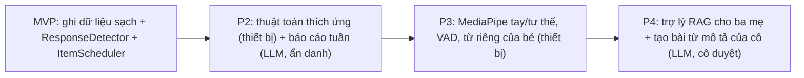

# 09 — Lộ trình AI

> Phiên bản 0.1 — nháp chờ Bao duyệt. **MVP không có tính năng AI.** Tài liệu này chốt: (1) AI sẽ làm gì, ở đâu, đo thế nào, hỏng thì sao; (2) quy tắc riêng tư; (3) dữ liệu MVP phải ghi ngay từ hôm nay. Mọi ngưỡng số dưới đây là **điểm khởi đầu đề xuất**, chưa kiểm chứng, và phải được cô giáo duyệt trước khi dùng cho quyết định can thiệp.

## 1. Nguyên tắc

| # | Nguyên tắc |
|---|---|
| 1 | AI phục vụ **ba mẹ và cô giáo**. Với bé, AI chỉ chạy ngầm trên thiết bị |
| 2 | **Không chatbot** nói chuyện tự do với bé |
| 3 | Ảnh, video, giọng nói của bé **không bao giờ được app truyền đi**. Đường duy nhất dữ liệu ra khỏi app là file sao lưu do ba mẹ chủ động xuất (`06` §6); app cảnh báo nếu ba mẹ chọn lưu lên dịch vụ đám mây |
| 4 | LLM cloud chỉ nhận **số liệu đã ẩn danh** (không tên, ảnh, giọng, ngày thật, ghi chú tự do) |
| 5 | **Mọi gợi ý thay đổi mục tiêu can thiệp cần người duyệt** (ba mẹ + cô giáo); AI không tự đổi |
| 6 | Luôn có phương án dự phòng không-AI (xác nhận tay, báo cáo mẫu, scheduler đơn giản) |
| 7 | Kiểm chứng trước khi bật: chạy "chế độ bóng" (shadow) rồi mới cho ảnh hưởng trải nghiệm |

### 1.1 Không làm

| Không | Lý do |
|---|---|
| Nhận diện cảm xúc của bé | Không đáng tin, rủi ro diễn giải sai, nhạy cảm |
| "Đánh giá mức độ tự kỷ", chẩn đoán, tiên lượng | Ngoài phạm vi; thuộc chuyên gia |
| Nhân bản giọng ba mẹ bằng AI | Luôn dùng giọng thu thật |
| AI tự đổi mục tiêu can thiệp | Cần người duyệt |
| Chấm chất lượng phát âm hay so với chuẩn phát triển | Có thể gây hiểu nhầm lâm sàng |

## 2. Tổng quan theo giai đoạn

| Mã | GĐ | Tính năng | Đầu vào | Mô hình / thuật toán | Chạy ở đâu | Dự phòng khi sai |
|---|---|---|---|---|---|---|
| AI-1 | P2 | Điều chỉnh độ khó tự động | `Trial`, `Session` (§3.1) | Lặp lại ngắt quãng (độ vững mỗi mục), thời gian chờ cá nhân hóa trong biên, luật giới thiệu mục mới | **Thiết bị** | `simple@1`; công tắc "Chế độ đơn giản" |
| AI-2 | P2 | Báo cáo tuần + gợi ý mục tiêu tuần sau | `AnonymousWeeklyStats` | Báo cáo mẫu xác định trước; LLM chỉ diễn đạt/gợi ý, có kiểm số liệu | **LLM cloud** (dữ liệu ẩn danh) | Báo cáo mẫu cục bộ |
| AI-3 | P3 | Nhận diện tay/tư thế: vỗ tay, vẫy tay, đứng lên, ngồi xuống | Khung hình camera (không lưu) | MediaPipe Hand/Pose Landmarker + bộ phân loại theo luật | **Thiết bị** | `parent_confirm` |
| AI-4 | P3 | Phát hiện bé phát âm (VAD) | Luồng micro (không lưu) | VAD năng lượng thích ứng → nâng cấp VAD mô hình nhỏ | **Thiết bị** | `parent_confirm` |
| AI-5 | P3 | Nhận vài từ riêng của bé ("chó", "xin") | `VocalClip` có nhãn (đồng ý) | Đặc trưng âm thanh + phân loại ít mẫu, huấn luyện trên máy | **Thiết bị** | `parent_confirm`; xóa clip/mô hình |
| AI-6 | P4 | Trợ lý hướng dẫn ba mẹ | Câu hỏi + tài liệu đã kiểm duyệt | RAG: truy xuất + LLM trả lời chỉ từ nguồn | LLM cloud | FAQ tĩnh + "hỏi cô giáo" |
| AI-7 | P4 | Cô mô tả bài bằng lời → JSON | Mô tả của cô + schema | LLM sinh JSON theo schema, Zod kiểm, cô duyệt | LLM cloud | Trình soạn bài thủ công |

## 3. Chi tiết từng tính năng

### 3.1 AI-1 — Điều chỉnh độ khó tự động (P2, thiết bị, không LLM)

| Mục | Nội dung |
|---|---|
| Đầu vào | Mỗi mục: lịch sử `promptLevel`, `correctFirstTry`, `firstChoice.latencyMs`, `isNewItem`, thời điểm gặp gần nhất; `Session.startedAt` (giờ trong ngày), `Session.observations` |
| Chọn mục cần ôn | Mỗi mục có "độ vững" `S` (ngày) và xác suất nhớ `p = 2^(−Δt/S)` (Δt = ngày từ lần gặp gần nhất). Cập nhật sau mỗi lượt: tự làm đúng → `S ← S·1.8`; cần gợi ý `gesture` → `S ← S·1.1`; cần mức cao hơn → `S ← max(S·0.7, 0.5)`. Ưu tiên mục có `p` thấp nhất (< 0,85) và đang trong mục tiêu tuần. Hệ số là giá trị khởi đầu, hiệu chỉnh bằng dữ liệu |
| Thời gian chờ trước gợi ý | `wait = clamp(1.5 × p75(latency tự làm đúng của loại mục), minWait, maxWait)`; **biên `[3 s, 8 s]` là giả định ⚠️ cô giáo phải duyệt**; ngoài biên không bao giờ đổi |
| Thời điểm thêm mục mới | Thêm mục mới khi các mục đang học đạt "đạt trên iPad" hoặc `p` đều > 0,85 và buổi gần nhất không có thẻ `tired`/`distress`; vẫn giữ ≤30% mục mới (GĐ-07) |
| Việc **cần người duyệt** | Thêm **bài** mới (Exercise) vào `WeeklyGoal`; đổi biên thời gian chờ; đổi tiêu chí đạt. Scheduler chỉ tự quyết thứ tự/mục trong các bài đã đặt |
| Khung giờ tốt nhất (nhắc lịch) | Nhóm buổi theo khung giờ; so sánh tỷ lệ hoàn thành và tự làm đúng; chỉ hiển thị khi ≥15 buổi, kèm n; là "gợi ý", không phải quy tắc |
| Đánh giá | (1) **Dự đoán ngoại tuyến**: với mỗi lượt, dự đoán `P(tự làm đúng)` trước khi biết kết quả, so với nền (tỷ lệ toàn cục) bằng log-loss/Brier + độ hiệu chuẩn. Cần ≥ ~200 lượt hợp lệ trong ≥3 tuần. (2) **Chế độ bóng 2 tuần**: tính kế hoạch nhưng chạy `simple@1`, so mục chọn. (3) **Xen kẽ tuần** (tuần A: đơn giản, tuần B: thích ứng) đo tỷ lệ tự làm, hoàn thành buổi, thẻ `engaged`. Dữ liệu 1 bé → chỉ mang tính tham khảo, không kết luận thống kê |
| Dự phòng | Ít hơn N lượt lịch sử hoặc dữ liệu bất thường → `simple@1`; công tắc "Chế độ đơn giản"; hiển thị lý do ("Ôn con chó vì đã 5 ngày chưa gặp"); ghi `Session.schedulerId` để đối chiếu |

### 3.2 AI-2 — Báo cáo tuần bằng tiếng Việt + gợi ý mục tiêu (P2, LLM cloud)

| Mục | Nội dung |
|---|---|
| Đầu vào | `AnonymousWeeklyStats` (`05` §8.3): ngày luyện, số lượt, tỷ lệ tự làm theo bài, phân bố mức gợi ý, thiên vị vị trí, mục mới/đạt, cầu nối theo bậc |
| Quy trình | (1) Dựng **báo cáo mẫu xác định** từ số liệu (không LLM) — luôn có. (2) Nếu ba mẹ đồng ý và xem trước nội dung gửi → gọi LLM để viết lại mạch lạc + đề xuất 1–3 **ứng viên mục tiêu** (mã bài trong danh sách cho phép). (3) Kiểm tự động. (4) Hiển thị là **"Bản nháp — chờ cô giáo duyệt"** |
| Mô hình | LLM cloud, nhà cung cấp **chưa chọn**. Tiêu chí chọn: hỗ trợ tiếng Việt tốt, đầu ra theo JSON Schema, không dùng dữ liệu để huấn luyện, thời gian lưu log tối thiểu |
| Chạy ở đâu | Gọi qua Cloudflare Worker không lưu trạng thái (khóa API không nằm trong app); CSP chỉ mở đúng origin |
| Đánh giá | **Bộ vàng** 20–30 tuần tổng hợp (gồm tuần không luyện, thiên vị vị trí, tiến bộ lớn, thụt lùi). **Kiểm tự động**: mọi con số trong văn bản xuất hiện trong số liệu đầu vào; không chứa từ cấm (§6); gợi ý chỉ thuộc danh sách mã bài cho phép; không có chẩn đoán/tiên lượng. **Kiểm người**: cô giáo chấm ≥10 báo cáo thật theo 4 tiêu chí (chính xác, dễ hiểu, an toàn, hữu ích) thang 1–5; tiêu chí an toàn phải đạt 100% (một lỗi an toàn = chặn phát hành) |
| Dự phòng | Bất kỳ lần kiểm nào trượt, LLM lỗi, hoặc không có mạng → hiển thị báo cáo mẫu cục bộ. Gợi ý mục tiêu **không tự áp dụng**: chỉ tạo `WeeklyGoal` (`source='suggestion_approved'`) sau khi ba mẹ bấm duyệt, kèm ô "đã hỏi cô giáo" |

Phiên bản không LLM của "Tóm tắt cuối tuần" (báo cáo mẫu) làm ở đầu P2; LLM bổ sung sau.

### 3.3 AI-3 — Nhận diện tay và tư thế (P3, thiết bị)

| Mục | Nội dung |
|---|---|
| Đầu vào | Khung camera thu nhỏ (ví dụ ~256 px), xử lý trong bộ nhớ, **không lưu, không gửi** |
| Mô hình | MediaPipe Tasks Vision: Hand Landmarker, Pose Landmarker (chạy WASM/GPU trên Safari — cần kiểm chứng ở P3). Bộ phân loại **theo luật** trên landmark: vẫy tay (cổ tay dao động theo trục ngang, biên độ/tần số trong cửa sổ ~1,5 giây); vỗ tay (khoảng cách hai cổ tay nhỏ rồi mở, lặp); xòe tay (độ dạng các ngón); đứng/ngồi (vị trí tương đối vai–hông–đầu gối). Chỉ huấn luyện bộ phân loại học máy nếu luật không đủ |
| Chạy ở đâu | Thiết bị; ba mẹ bật cho từng buổi; chỉ báo "camera đang bật" hiện rõ; tắt mặc định |
| Đánh giá | **Chế độ bóng:** detector chỉ **đề xuất**, ba mẹ vẫn xác nhận (`parent_confirm`). So khớp: precision/recall/F1 từng cử chỉ so với xác nhận của ba mẹ, tối thiểu ~50 sự kiện/cử chỉ, nhiều điều kiện ánh sáng/góc/có người lớn trong khung. **Ngưỡng đề xuất** (cần cô duyệt): precision ≥ 0,9 và recall ≥ 0,8 mới cho phép "điền sẵn" nút xác nhận; **không bao giờ tự xác nhận** không có ba mẹ ở P3 |
| Dự phòng | `parent_confirm` luôn có; mất camera/quyền → nút tay; nhiều người trong khung → chỉ hiển thị đề xuất, không ghi tự động |
| Dữ liệu để đánh giá (ghi từ P2) | Sự kiện `parentConfirm` của `coach_demo` kèm `poseId` và mốc thời gian (`02` IMI-02/03, COG-02) |

### 3.4 AI-4 — Phát hiện bé phát âm (VAD, P3, thiết bị)

| Mục | Nội dung |
|---|---|
| Đầu vào | Luồng micro, cửa sổ ~30 ms, xử lý tại chỗ; **không cần nhận đúng từ** |
| Thuật toán | Bước 1: VAD năng lượng + tốc độ qua điểm không với nền ồn thích ứng và độ trễ (hysteresis). Bước 2 (nếu không đủ): mô hình VAD nhỏ chạy WASM (ví dụ loại giấy phép MIT — cần xác nhận trước khi dùng) |
| Vấn đề đã biết | Âm thanh của chính app, giọng ba mẹ và tiếng TV bị nhầm là bé → chỉ nghe trong **cửa sổ sau câu lệnh**, tắt khi app đang phát, `echoCancellation`/`noiseSuppression`, ba mẹ giữ yên lặng trong cửa sổ |
| Đánh giá | Precision/recall "có tiếng bé" so với nhãn của ba mẹ ở nhiều điều kiện ồn (yên tĩnh, TV, ba mẹ nói); chế độ bóng trước. Ngưỡng khởi điểm như AI-3, cô duyệt |
| Dự phòng | `parent_confirm`; có nút "Bé vừa nói" |
| Lưu ý | Ghi lại **có/không** và thời điểm; ghi âm clip chỉ khi ba mẹ bật tùy chọn `VocalClip` (AI-5) |

### 3.5 AI-5 — Nhận vài từ riêng của bé (P3, thiết bị)

| Mục | Nội dung |
|---|---|
| Đầu vào | `VocalClip` ngắn do ba mẹ **đồng ý lưu** và gắn nhãn từ ("chó", "xin"); chỉ trên thiết bị; nút **xóa toàn bộ** |
| Mô hình | Đặc trưng âm thanh (ví dụ log-mel hoặc embedding từ mô hình giọng nói mở có giấy phép phù hợp) + bộ phân loại ít mẫu (k-NN/prototype hoặc đầu nhỏ) **huấn luyện trên máy** theo clip của bé. Không dùng mô hình giọng nói tổng quát để chấm phát âm |
| Đánh giá | Kiểm chéo bỏ-một (leave-one-out) theo từng từ; ưu tiên **precision** (tránh báo "đúng" sai); số clip tối thiểu mỗi từ (khởi điểm ~20, cần thử); chỉ hiển thị đề xuất khi precision đủ ngưỡng |
| Hiển thị | "Có vẻ bé vừa nói 'chó' — đúng không?" ba mẹ bấm xác nhận; không điểm số, không so chuẩn |
| Dự phòng | `parent_confirm`; xóa clip thì xóa luôn mô hình |
| Điều kiện | Có đồng ý bằng văn bản trong app (`Child.consents.vocalClips`), mặc định tắt |

### 3.6 AI-6 — Trợ lý hướng dẫn ba mẹ (P4, RAG)

| Mục | Nội dung |
|---|---|
| Đầu vào | Câu hỏi của ba mẹ (không kèm dữ liệu bé); kho tài liệu **đã kiểm duyệt** (mô tả bài, hướng dẫn cầu nối, an toàn) |
| Cơ chế | Truy xuất đoạn liên quan → LLM chỉ trả lời từ các đoạn, kèm trích dẫn; bộ phân loại phạm vi: chẩn đoán, tiên lượng, thuốc, so sánh với trẻ khác, "bé có tự kỷ nặng không" → trả lời mẫu: *nên hỏi chuyên gia* |
| Đánh giá | Bộ ≥200 câu hỏi gồm tình huống đối kháng; **độ bám nguồn** (trích dẫn hỗ trợ câu trả lời); tỷ lệ từ chối đúng với nhóm chẩn đoán/tiên lượng phải ≈100% (tiêu chí chặn phát hành); cô giáo lấy mẫu duyệt định kỳ |
| Dự phòng | FAQ tĩnh + liên hệ cô giáo; không trả lời khi truy xuất không đủ tin cậy |

### 3.7 AI-7 — Cô giáo mô tả bài → JSON (P4)

| Mục | Nội dung |
|---|---|
| Đầu vào | Mô tả bằng lời + schema `Exercise` (`06` §4.1) + ví dụ |
| Cơ chế | LLM sinh JSON theo schema (đầu ra có cấu trúc) → Zod kiểm → **xem trước** (chạy thử bài ở chế độ ba mẹ) và so sánh khác biệt → cô duyệt → `Exercise.configVersion` tăng, `confirm.by` ghi tên cô |
| An toàn | Schema ràng buộc cứng `sensory.noWrongSound=true`, `noText=true`; AI không thể tạo bài có âm báo sai |
| Đánh giá | Bộ mô tả→JSON chuẩn: tỷ lệ hợp lệ schema, độ đúng từng trường, số lần cô phải sửa |
| Dự phòng | Trình soạn bài bằng biểu mẫu; mẫu JSON |

## 4. Quyền riêng tư và ẩn danh hóa

### 4.1 Quy tắc

| # | Quy tắc |
|---|---|
| 1 | Dữ liệu gốc (ảnh, giọng, tên, ngày sinh) **chỉ ở thiết bị**; CSP `connect-src 'self'` ở MVP; P2 chỉ mở đúng origin Worker |
| 2 | Gửi LLM: **chỉ** `AnonymousWeeklyStats`, dựng bằng **danh sách trắng** (xây mới từng trường), **không** "lọc bớt" từ đối tượng đầy đủ |
| 3 | Mỗi tính năng có đồng ý riêng, mặc định **tắt**; ba mẹ **xem trước chính xác nội dung sẽ gửi** và có thể hủy |
| 4 | Nhật ký cục bộ những gì đã gửi (thời điểm, tính năng, mã băm), ba mẹ xem/xóa được |
| 5 | Không gửi ghi chú tự do, tên, ảnh, âm thanh, tọa độ chạm, ID thiết bị |
| 6 | Worker không ghi nội dung yêu cầu; tắt log thân yêu cầu; LLM nhà cung cấp phải cam kết không huấn luyện trên dữ liệu (kiểm tra điều khoản trước khi chọn) |
| 7 | Xóa dữ liệu: "Xóa toàn bộ" xóa luôn `VocalClip`, mô hình riêng và nhật ký gửi |
| 8 | Tuân thủ Nghị định 13/2023/NĐ-CP khi mở rộng (cần tư vấn pháp lý, Q-14); không suy diễn điều khoản trong tài liệu này |

### 4.2 Bảng ẩn danh hóa

| Trường | Xử lý khi gửi LLM |
|---|---|
| `Child.displayName`, ảnh, giọng | **Không gửi** |
| `birthMonth` | Chuyển thành nhóm tuổi theo tháng: `'24-29' \| '30-35' \| '36-41'` |
| Ngày thật (`date`, `weekStart`) | Thay bằng `weekIndex` tương đối (0,1,2…) |
| Tên mục: con vật nuôi | Giữ mã chung (`animal.dog`) |
| Tên mục: đồ cá nhân | `personal_object_N` (không giữ nhãn thật) |
| Phần thưởng thật | `reward_N` |
| `parentNote`, `Session.observations` dạng văn bản | **Không gửi** (thẻ quan sát chuẩn hóa có thể gộp thành đếm) |
| `touches[]` (tọa độ), `viewport` | **Không gửi** |
| Số liệu tổng hợp (tỷ lệ, số lượt, phân bố mức gợi ý) | Gửi |

## 5. Dữ liệu MVP phải ghi để các tính năng khả thi

| Dữ liệu (trường trong `06`) | Phục vụ | Ghi chú |
|---|---|---|
| `Trial.promptLevelAuto`, `promptLevel`, `promptLevelSource` | AI-1, AI-2 | Giữ cả giá trị gốc và sửa |
| `Trial.firstChoice.latencyMs`, `completedLatencyMs` | AI-1 (thời gian chờ) | Từ cuối câu lệnh |
| `Trial.isNewItem`, `targetItemKey`, `displayed[].slot`, `targetSlot` | AI-1, AI-2, thiên vị vị trí | |
| `Trial.touches[]` | Độ chính xác chạm (Q-03), kiểm AI-1 | Không gửi ra ngoài |
| `Trial.appCue`, `parked` | AI-1 | |
| `Trial.valid`, `invalidReason` | Làm sạch dữ liệu huấn luyện/đánh giá | |
| `Trial.schedulerId`, `Session.schedulerId`, `configSnapshot` | So sánh thuật toán | |
| `Session.startedAt`, `durationMs`, `status`, `observations` | Khung giờ tốt nhất, hứng thú, đánh giá chế độ bóng | |
| `GeneralizationCheck` | AI-2, tổng quát hóa | |
| `Milestone` | Báo cáo | |
| Sự kiện `parentConfirm` + `poseId`/`vocalization` (P2) | Chân lý để đánh giá AI-3/4/5 | |
| `schemaVersion` mọi bản ghi | Di trú dữ liệu | |
| Khối lượng tối thiểu | ≥ ~200 lượt hợp lệ trong ≥3 tuần trước khi chạy chế độ bóng AI-1 |

## 6. Từ cấm và kiểm văn bản

Danh sách khởi điểm (cô giáo rà soát và bổ sung); áp dụng cho `i18n/vi.ts`, báo cáo mẫu và đầu ra LLM. Kiểm bằng test tự động trên `vi.ts` và bộ kiểm đầu ra LLM.

| Nhóm | Ví dụ từ/cụm bị cấm | Thay bằng |
|---|---|---|
| Tuyên bố y khoa | "chữa", "chữa khỏi", "điều trị", "giảm triệu chứng", "cải thiện tự kỷ", "chẩn đoán", "tiên lượng", "mức độ tự kỷ", "nặng/nhẹ" (về tự kỷ) | "hỗ trợ luyện tập", "quan sát" |
| So sánh/đánh giá bé | "bình thường", "bất thường", "chậm phát triển", "kém", "điểm yếu" | Mô tả hành vi quan sát được |
| Từ gây tội lỗi/phạt | "thất bại", "bỏ lỡ", "đứt chuỗi", "phạt", "mất sao", "sai" (dùng cho kết quả của bé) | "chưa", "để lần sau", "cần giúp" |
| Hứa hẹn | "chắc chắn sẽ", "đảm bảo tiến bộ" | "dữ liệu cho thấy", kèm n |

Quy tắc: mọi số liệu đi kèm số lượt (n); không kết luận khi n nhỏ; luôn có câu "cô giáo là người đánh giá" ở báo cáo/ gợi ý.

## 7. Cổng bật tính năng AI

| Điều kiện | AI-1 | AI-2 | AI-3/4/5 | AI-6/7 |
|---|---|---|---|---|
| Đủ dữ liệu (§5) | ✔ | ✔ | ✔ (P2 `parent_confirm` đã có nhãn) | — |
| Chế độ bóng đạt ngưỡng, cô duyệt | ✔ | ✔ (bộ vàng + cô chấm) | ✔ | ✔ (bộ đối kháng) |
| Dự phòng không-AI đã chạy tốt | ✔ | ✔ | ✔ | ✔ |
| Ba mẹ đồng ý riêng, xem trước dữ liệu | — | ✔ | ✔ | ✔ |
| Tư vấn pháp lý (Q-14) | — | ✔ | ✔ | ✔ |
